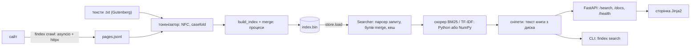
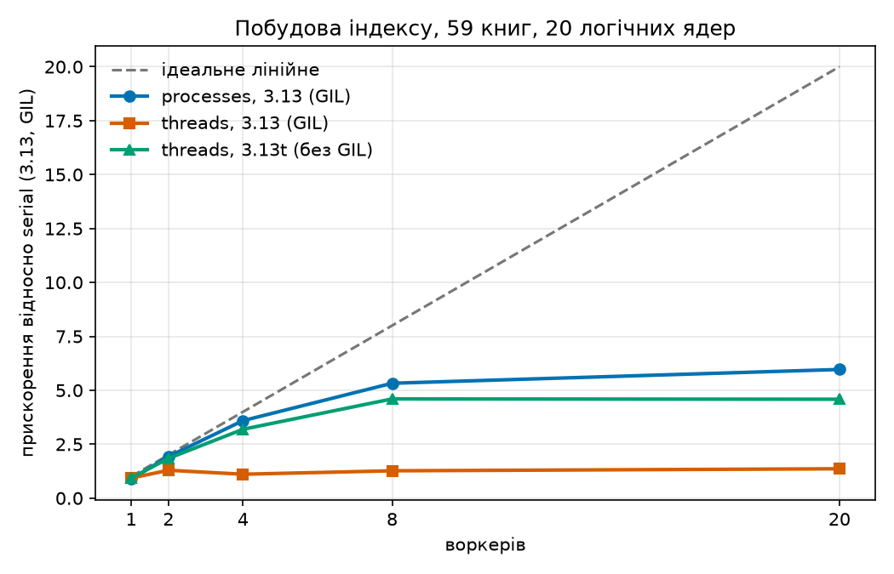

# findex

[](https://github.com/ds0903/findex/actions/workflows/ci.yml)

**findex шукає по текстах: індексує 59 книг, ранжує відповіді за BM25 і віддає їх зі сніпетами через
командний рядок, HTTP API та веб-сторінку.** Усе написано на Python 3.13 по лабораторних курсу, по одній
частині на лабу.

| | |
|---|---|
| Жива адреса | **ще не розгорнуто** (Dockerfile і `render.yaml` готові, деплой з мого акаунта я не робив) |
| GIF пошуку | **ще не записано** |
| Відео на 2-3 хв | **ще не записано** |

### Три головні числа

| | |
|---|---|
| Корпус | **59 книг**, 54,7 МБ, 9 735 664 токени, 585 490 постінгів |
| p95 відповіді `/search` | **1,8 с** при 50 одночасних з'єднаннях, 4 воркери, один ноутбук (p50 0,57 с). Знято на коді лаби 7; після прискорення сніпетів у лабі 8 не перемірювано |
| Найбільше прискорення | **x26**: рейтинг на NumPy проти Python для частого терма, синтетичний індекс на 200 тис. документів. На реальному корпусі з 59 книг виграш скромний: x1,7-1,9 (рідкий терм навіть повільніший, x0,4) |

### Шлях даних



### Усі виміри в одному місці

Кожен рядок це головний результат лаби; повна таблиця, умови заміру і що в ній слабке лежать у розділі лаби.
Машина скрізь одна: i9-13900H, Windows 11, Python 3.13.7. Числа від прогону до прогону плавають, місцями
на третину.

| Лаба | Що міряли | Результат | Розділ |
|---|---|---|---|
| 1 | пам'ять: lazy проти eager, 59 книг | пік 81,8 МБ проти 601,3 МБ (x7,4), час однаковий | [Вимірювання](#вимірювання-lazy-проти-eager) |
| 2 | сховища постінгів | після побудови 79 / 56 / 46 МБ (plain / slots / array); файл binary 6,6 МБ, load 0,17-1,75 с | [Лаба 2](#лаба-2-інвертований-індекс) |
| 2 | булів пошук: merge проти set | на коротких списках set швидший у 1,5-2,3 раза, на списках по 100 тис. merge швидший у 1,1-1,3 раза | [Булів пошук](#булів-пошук-merge-проти-set) |
| 3 | якість: precision@5 на 10 запитах | TF-IDF 0,36, BM25 0,38, стеля 0,46 | [Якість](#якість-precision5-на-10-запитах) |
| 4 | типи, тести, CLI, пакет, CI | pyright strict, wheel, тег `lab-04` і реліз v0.4.0 (виміру в цій лабі нема) | [Лаба 4](#лаба-4-типи-тести-cli-і-пакування) |
| 5 | паралельна побудова індексу | 19,51 с серійно, 3,27 с на 20 процесах (x5,96); потоки з GIL лише x1,36; потоки без GIL (3.13t) x4,60 | [Лаба 5](#лаба-5-паралельна-побудова-gil-і-313t) |
| 6 | асинхронний краулер, 298 сторінок | 11,4 стор/с з 1 запитом, 169,2 стор/с з 20 одночасними (x14,9); з лімітом 2 на хост 22,6 | [Лаба 6](#лаба-6-асинхронний-краулер) |
| 7 | `def` проти `async def` для `/search` | пропускна здатність однакова (≈1,7 запиту/с), але `/health` під навантаженням відповідає за 1,1 с проти 12,3 с | [Лаба 7](#лаба-7-пошук-у-вебі-fastapi-pydantic-docker) |
| 7 | сервіс під навантаженням, 50 одночасних | 7,79 (1 воркер, `async def`), 12,14 (1 воркер, `def`), 53,93 запиту/с (4 воркери) | [Лаба 7](#лаба-7-пошук-у-вебі-fastapi-pydantic-docker) |
| 8 | рейтинг: Python проти NumPy | x26 / x7 / x0,7 (частий / три терми / рідкий) на 200 тис. документів; x1,7 / x1,9 / x0,4 на реальному корпусі | [Лаба 8](#лаба-8-швидше-потім-розумніше-профілювання-numpy-memmap) |
| 8 | сніпети: швидший пошук збігів | 73,9 -> 27,6 мс на книгу (x2,7); 5 пошуків зі сніпетами 4,40 -> 2,63-2,72 с (x1,7) | [Лаба 8](#лаба-8-швидше-потім-розумніше-профілювання-numpy-memmap) |
| 8 | NumPy-індекс на диску: memmap і дельти | load 0,283 с (лаба 2) -> 0,025 с (memmap); `doc_id` стиснуто вдвічі | [Лаба 8](#лаба-8-швидше-потім-розумніше-профілювання-numpy-memmap) |

### Обмеження

- **Нічого не розгорнуто.** Публічної адреси нема, Docker-образ на моїй машині не збирався (там нема Docker),
  `oha` не запускався (навантаження знято власним клієнтом). Це лишилося мені зробити.
- **Корпус малий.** 59 книг: списки постінгів короткі, а тому виграш NumPy і скромний на реальних даних.
  Великі виграші виміряні на синтетичному індексі (слова з розподілом Ципфа), а не на справжніх текстах.
- **Якість виміряна на 10 запитах** з моєю власною розміткою (лаба 3): різниця між BM25 і TF-IDF це один запит.
- **Семантичного пошуку нема.** Ембедингів, `findex embed`, режимів `semantic` і `hybrid` я не робив; замість
  цього лаба 8 має memmap і стиснення на збільшеному індексі (дозволена альтернатива).
- **Індекс повністю лежить у пам'яті кожного воркера** (≈525 МБ з позиціями): чотири воркери це ≈2 ГБ.
  Безкоштовний план на 512 МБ його, ймовірно, не вмістить.
- **Стиснення дельтами працює лише до 65 536 документів**: далі різниця між сусідніми `doc_id` не влазить
  у `uint16` (функція кидає `ValueError`); для більших індексів потрібен `uint32` або кодування змінної довжини.
- **Сніпети** щоразу читають книгу з диска (є LRU на 128 текстів) і лишаються найповільнішою частиною запиту.
- Усі виміри зняті на Windows, на одній машині, з розкидом між прогонами до третини.

### Відео

*Ще не записано* (2-3 хвилини: запуск сервісу, пошук на сторінці, один вимір).

---

Репозиторій веду по лабораторних. Кожна лаба закінчується тегом (`lab-01`, `lab-02`, ...):

- **Лаба 1** (тег `lab-01`) — ітератори, генератори й потоковий розбір корпусу текстів.
- **Лаба 2** (тег `lab-02`) — інвертований індекс, булів пошук, збереження індексу,
  порівняння пам'яті різних структур даних. Опис і таблиці — в розділі
  [Лаба 2](#лаба-2-інвертований-індекс) нижче.
- **Лаба 3** (тег `lab-03`) — клас `Index`, ранжування (TF-IDF і BM25), парсер мови запитів
  з дужками й фразами, кеш, сніпети. Розділ [Лаба 3](#лаба-3-ранжування-і-мова-запитів).
- **Лаба 4** (тег `lab-04`, реліз [v0.4.0](https://github.com/ds0903/findex/releases/tag/v0.4.0)) —
  типи (pyright strict), тести (pytest, Hypothesis, покриття), CLI на typer + rich, пакет із wheel,
  CI. Розділ [Лаба 4](#лаба-4-типи-тести-cli-і-пакування).
- **Лаба 5** (тег `lab-05`) — паралельна побудова індексу (`build_partial` + `merge`), потоки проти
  процесів, GIL і Python 3.13t. Розділ [Лаба 5](#лаба-5-паралельна-побудова-gil-і-313t).
- **Лаба 6** (тег `lab-06`) — асинхронний краулер на asyncio і httpx: `findex crawl`.
  Розділ [Лаба 6](#лаба-6-асинхронний-краулер).
- **Лаба 7** (поки без тегу: чекає на деплой і oha) — HTTP API на FastAPI, сторінка Jinja2, Docker.
  Розділ [Лаба 7](#лаба-7-пошук-у-вебі-fastapi-pydantic-docker).
- **Лаба 8** (поки без тегу: чекає на деплой, GIF і відео) — профілювання (cProfile, py-spy), рейтинг на NumPy,
  швидші сніпети, memmap і стиснення індексу. Розділ
  [Лаба 8](#лаба-8-швидше-потім-розумніше-профілювання-numpy-memmap).

Що є з лаби 1:

- `iter_documents()` — генератор, читає документи з теки по одному;
- `tokenize()` — потоковий токенізатор з Unicode-нормалізацією;
- `findex stats` — статистика корпусу за один прохід (документи, токени, словник, топ-50 термів,
  час і пікова пам'ять);
- «жадібна» версія тієї ж статистики через списки, щоб порівняти пам'ять.

## Корпус

Книги з [Project Gutenberg](https://www.gutenberg.org/) у форматі plain text (UTF-8):
59 книг, 54,7 МБ, майже все англійською (Діккенс, Толстой, Шекспір, Гюго у перекладах тощо)
плюс кілька книг французькою, німецькою та російською, щоб було на чому перевіряти Unicode.

Сам корпус у репозиторій не входить (`data/` у `.gitignore`). Завантажити:

```
uv run python scripts/download_corpus.py
```

Скрипт кладе файли в `data/gutenberg/` і пропускає ті, що вже є.
Шапку й ліцензію Gutenberg `iter_documents` відрізає за маркерами `*** START OF ...` / `*** END OF ...`.

## Запуск

```
uv sync
uv run findex stats data/gutenberg                # статистика, lazy-версія
uv run findex stats data/gutenberg --limit 10     # лише перші 10 документів (islice)
uv run findex stats data/gutenberg --eager        # жадібна версія зі списками
uv run findex stats data/gutenberg --no-memory    # без tracemalloc, тільки час
uv run pytest
uv run ruff check
```

Порівняння двох версій (таблиця нижче):

```
uv run python scripts/compare.py data/gutenberg 10 30 59
```

## Структура

```
src/findex/
    documents.py   Document, iter_documents()
    tokenizer.py   tokenize()
    stats.py       collect_stats(), collect_stats_eager(), measure()     (лаба 1)
    cli.py         команди `findex index / search / stats` (typer, rich) (лаба 1, 4)
    index.py       Posting, DocMeta, Index, build_index()                (лаба 2)
    search.py      булів пошук: merge і set                              (лаба 2)
    store.py       save() / load(): pickle і binary                      (лаба 2)
    measure.py     час і пік пам'яті (tracemalloc)                       (лаба 2)
    parallel.py    build_partial, merge, build_parallel, executor-и      (лаба 5)
    query.py       парсер запитів, вузли Term/Phrase/And/Or/Not          (лаба 3)
    ranking.py     Scorer, TfIdf, BM25, SearchResult, top_k              (лаба 3)
    searcher.py    Searcher: пошук з кешем запитів                       (лаба 3)
    snippets.py    уривки тексту з підсвіченими термами                  (лаба 3)
    timing.py      декоратор @timed                                      (лаба 3)
    logconfig.py   налаштування logging для CLI                          (лаба 3)
    crawl/         асинхронний краулер: findex crawl                     (лаба 6)
    web/           FastAPI-сервіс, сторінка, налаштування: findex serve  (лаба 7)
    vectorized.py  NumpyIndex, рейтинг і top-k на масивах NumPy          (лаба 8)
scripts/
    download_corpus.py
    compare.py                                                           (лаба 1)
    bench_index.py, bench_search.py, bench_load.py                       (лаба 2)
    sanity_ranking.py, eval_ranking.py                                   (лаба 3)
    bench_parallel.py, plot_speedup.py, race_demo.py                     (лаба 5)
    serve_site.py, bench_crawl.py                                        (лаба 6)
    load_test.py, run_load_rows.py, bench_sync_async.py                  (лаба 7)
    profile_hotspots.py, bench_numpy.py                                  (лаба 8)
docs/
    speedup.png, bench/results.json                                      (лаба 5)
tests/
```

## Правила токенізатора

Повний опис — у докстрингу `src/findex/tokenizer.py`, тут коротко:

1. Текст → NFC → `casefold()` → NFC. `casefold`, а не `lower`: `Straße` → `strasse`.
   NFC потрібен, щоб `é` одним символом і `e` + U+0301 були одним токеном.
2. Токен — послідовність букв і цифр будь-якого алфавіту. Підкреслення розділяє слова
   (в Gutenberg ним позначено курсив: `_word_`).
3. Апостроф усередині слова лишається: `don't`, `м'ясо`. Типографський `’` та `ʼ` стають звичайним `'`.
   Апострофи по краях (`'hello'`, `dogs'`) відкидаються.
4. Дефіс між двома шматками слова лишається: `well-known`, `2020-2021`. Тире (`—`, `–`, `--`)
   розділяють слова.
5. Цифри — звичайні символи слова: `covid19`, `1984`. Але `3.14` дає `3` і `14`, а `1,000` — `1` і `000`.

Відоме обмеження: комбіновані символи без попередньо складеної форми не входять у `\w`
і розбивають слово.

## Вимірювання: lazy проти eager

Обидві версії рахують одне й те саме (документи, токени, словник, топ-50) і дають однакову відповідь
(це перевіряє тест). Різниця тільки в тому, як вони поводяться з пам'яттю:

- **lazy** (`collect_stats`): документи йдуть по одному, токени віддає генератор і одразу
  потрапляють у `Counter`. Нічого не накопичується, крім самого лічильника.
- **eager** (`collect_stats_eager`): спочатку `list(documents)` (усі тексти разом), потім
  `list(tokenize(...))` для кожного документа і один великий список усіх токенів, і вже з нього `Counter`.

Пам'ять — пік за `tracemalloc`, час — `time.perf_counter()`. Для кожного рядка таблиці робилося
два запуски: без `tracemalloc` (час) і з ним (пам'ять), бо `tracemalloc` сильно сповільнює код
(на 10 документах 4,9 с без нього проти 34,3 с з ним).

| версія | документів | токенів | словник | пік пам'яті, МБ | час, с |
|---|---:|---:|---:|---:|---:|
| lazy | 10 | 2 849 400 | 56 042 | 81,8 | 4,94 |
| eager | 10 | 2 849 400 | 56 042 | 187,1 | 4,68 |
| lazy | 30 | 5 030 791 | 86 526 | 81,8 | 8,93 |
| eager | 30 | 5 030 791 | 86 526 | 308,7 | 8,52 |
| lazy | 59 | 9 735 664 | 135 872 | 81,8 | 17,67 |
| eager | 59 | 9 735 664 | 135 872 | 601,3 | 16,33 |

Машина: Windows 11, Python 3.13. Час між запусками плаває на кілька секунд (повний прохід через
CLI показав 26,5 с проти 17,7 с у таблиці), тому різницю в часі між lazy й eager в межах
10% вважаю шумом. Різниця в пам'яті шумом не є.

### Куди пішла пам'ять

**Eager, 59 документів, 601 МБ.** Складається з трьох великих шматків (виміряно окремо):

| що | МБ |
|---|---:|
| тексти всіх 59 документів одночасно | 102,1 |
| 9,7 млн окремих рядків-токенів (у середньому по 45,5 байта кожен) | 406,5 |
| вказівники великого списку токенів (8 байтів × 9,7 млн) | 74,3 |

Разом близько 583 МБ, решта — лічильник, проміжні списки окремих документів тощо.
Головна стаття витрат — об'єкти `str`: навіть слово `the` у Python займає 44 байти
(порожній рядок — 41), хоча в тексті це 3 символи. Тексти важать удвічі більше, ніж файли
на диску (54,7 МБ), бо в усіх 59 документах є не-ASCII символи (лапки, `™` тощо),
а такі рядки зберігаються по 2 байти на символ. І все це росте лінійно з розміром корпусу:
10 → 30 → 59 документів дає 187 → 309 → 601 МБ.

**Lazy — рівно 81,8 МБ у всіх трьох рядках.** Пам'ять не росте з корпусом, але й нулем не є.
Пік визначається не кількістю документів, а найбільшим одним документом:
у порядку обходу першим іде `pg100.txt` (повний Шекспір, 5,4 МБ), тому вже в запуску на 10 документах
пік потрапляє на нього, а далі більших не трапляється. Розбивка на цьому файлі:

| крок | пік, МБ |
|---|---:|
| `read_text` (рядок із 5,4 млн символів = 10,3 МБ) | 26,7 |
| + `strip_boilerplate` | 30,7 |
| + `normalize` (NFC, `casefold`, NFC) | 81,8 |
| повний lazy-прохід по цьому документу | 81,8 |

Тобто сам пік дає `normalize()`, яка робить кілька проміжних копій цілого документа. Решта lazy-пам'яті
— це `Counter` зі словником (135 872 терми) і поточний документ. Токени ж не накопичуються взагалі.

Висновок: lazy-версії потрібно пам'яті «на один найбільший документ + словник», і це не залежить
від числа документів, а eager-версії — «весь корпус, помножений на розмір об'єкта `str`».
Якщо документи будуть величезні, наступний крок — нормалізувати по рядках, а не цілим текстом.

## Приклад виводу

`uv run findex stats data/gutenberg --limit 10 --top 10`:

```
версія:       lazy (генератори)
документів:   10
токенів:      2849400
словник:      56042
час:          34.34 с (з tracemalloc, тому повільніше)
пік пам'яті:  81.8 МБ

топ-10 термів:
   1. the                  138375
   2. and                  85959
   3. of                   72825
   4. to                   72510
   5. a                    58297
   6. i                    55806
   7. in                   43969
   8. you                  36939
   9. that                 35839
  10. he                   33736
```

<details>
<summary>Весь корпус, топ-50 (<code>uv run findex stats data/gutenberg --top 50 --no-memory</code>)</summary>

```
версія:       lazy (генератори)
документів:   59
токенів:      9735664
словник:      135872
час:          26.54 с
пік пам'яті:  не мірялась

топ-50 термів:
   1. the                  497269
   2. and                  340819
   3. of                   256626
   4. to                   249249
   5. a                    190142
   6. i                    165205
   7. in                   151350
   8. that                 129076
   9. he                   126549
  10. it                   105330
  11. his                  101254
  12. was                  100583
  13. you                  91526
  14. with                 82534
  15. is                   75609
  16. for                  75574
  17. as                   73022
  18. not                  69391
  19. my                   62740
  20. had                  61781
  21. her                  61249
  22. but                  61194
  23. him                  57609
  24. be                   57176
  25. at                   56348
  26. on                   54504
  27. me                   50617
  28. have                 50524
  29. she                  46599
  30. this                 45915
  31. all                  45914
  32. said                 44871
  33. so                   44206
  34. by                   42556
  35. they                 40274
  36. which                40197
  37. from                 36124
  38. what                 33737
  39. no                   31809
  40. there                30979
  41. one                  30792
  42. or                   30121
  43. were                 29993
  44. are                  29685
  45. when                 28651
  46. if                   28559
  47. will                 27590
  48. we                   27240
  49. them                 26306
  50. your                 26088
```

</details>

## Лаба 2. Інвертований індекс

Індекс будується одним проходом по тому самому лінивому пайплайну з лаби 1
(`iter_documents` → `tokenize`): тексти не накопичуються, в пам'яті росте тільки індекс.
Для кожного терма зберігається список постінгів `Posting(doc_id, tf)`, відсортований
за `doc_id`, а ще довжини документів (`doc_lengths`) і метадані для показу результатів
(`doc_meta`: шлях і назва книги з рядка `Title:` у шапці Gutenberg).

На нашому корпусі (59 книг): **585 490 постінгів, 135 872 термів**. У середньому терм
трапляється лише в 4,3 документах, тобто в більшості термів список постінгів дуже короткий.
Це важливо для таблиці пам'яті нижче.

### Запуск

```
uv run python -m findex.index data/gutenberg --out data/index.bin     # побудувати й зберегти
uv run python -m findex.search data/index.bin "whale harpoon"         # шукати по збереженому
uv run python -m findex.search data/index.bin "cat NOT dog" --engine set
```

Прапорці `findex.index`: `--format {binary,pickle}` (за замовчуванням `binary`),
`--storage {slots,plain,array}`, `--positions`, `--limit N`, `--no-memory`.
Прапорці `findex.search`: `--engine {merge,set}`, `--limit N`, `--no-memory`.

Запит: слова через пробіл — це AND, `OR` і `NOT` пишуться великими літерами, обчислення
зліва направо без дужок (справжній парсер буде в наступних лабах). *У лабі 3 це змінилося:
з'явилися дужки, пріоритет операцій і фрази, див. нижче; таблиця далі описує лабу 2.*

| запит | значення |
|---|---|
| `cat dog` | cat AND dog |
| `cat OR dog` | cat або dog |
| `cat NOT dog` | cat, але без dog |
| `NOT cat` | усі документи, де cat немає |
| `a OR b NOT c` | `(a OR b) NOT c` |

Приклад (весь корпус). Побудова:

```
документів:   59
термів:       135872
постінгів:    585490
сховище:      slots, позиції: ні
побудова:     132.48 с
збереження:   0.91 с -> data\index.bin (6.6 МБ, binary)
пік пам'яті:  90.1 МБ (tracemalloc, тому час більший)
```

Пошук по збереженому файлу (`uv run python -m findex.search data/index.bin "whale harpoon"`):

```
запит: 'whale harpoon', engine: merge
знайдено документів: 2
    32  Moby Dick; Or, The Whale  (pg2701.txt)
    40  Ulysses  (pg4300.txt)
завантаження: 7.441 с
пошук:        0.174 мс
пік пам'яті:  69.3 МБ (tracemalloc)
```

Завантаження тут 7,4 с лише через `tracemalloc`; з `--no-memory` той самий індекс
завантажується за 0,63 с.

### Структури

- `Posting(doc_id, tf, positions=())` і `DocMeta(path, title)` — `@dataclass(frozen=True, slots=True)`.
  Вони незмінні й хешовані (їх можна класти в `set` і брати за ключі `dict`): для `frozen=True` + `eq=True`
  dataclass сам генерує `__hash__` з полів, тож рівні об'єкти мають рівні хеші.
- `PlainPosting` — те саме, але без `slots`; існує лише для порівняння пам'яті.
- Під час побудови постінги збираються в `defaultdict`, а на виході він перетворюється на звичайний
  `dict`, щоб пошук неіснуючого терма не створював у індексі порожніх записів.
- Для кожного документа ведеться окремий `Counter`, який скидається в індекс після документа
  й одразу зникає.
- Позиції токенів (`--positions`) — опційно, їхню ціну виміряно нижче.

### Булів пошук: merge проти set

`merge_and/or/diff` — двовказівниковий прохід по двох відсортованих списках, `O(len(a) + len(b))`,
без хешування. `set`-версія робить `sorted(set(a) & set(b))` (і аналогічно для OR/NOT);
`sorted` потрібен, щоб результат лишався відсортованим для наступних кроків запиту, тож він
входить у час `set`-версії. Скрипт: `uv run python scripts/bench_search.py data/gutenberg`,
для кожного рядка береться найкращий із 5 замірів, один виклик у мікросекундах.

Два найчастіші терми корпусу: `in` (59 документів) і `a` (58); два найрідші (df = 1, перші за
абеткою): `00` і `0023m`.

| терми | операція | len(a) | len(b) | результат | merge, мкс | set, мкс | швидше |
|---|---|---:|---:|---:|---:|---:|---|
| in / a | AND | 59 | 58 | 58 | 12,2 | 5,2 | set (x2,3) |
| in / a | OR | 59 | 58 | 59 | 10,5 | 6,3 | set (x1,7) |
| in / a | NOT | 59 | 58 | 1 | 10,2 | 4,6 | set (x2,2) |
| 00 / 0023m | AND | 1 | 1 | 0 | 0,4 | 0,7 | merge (x1,6) |
| 00 / 0023m | OR | 1 | 1 | 2 | 0,9 | 0,9 | порівну |
| in / 00 | AND | 59 | 1 | 1 | 4,5 | 2,4 | set (x1,9) |
| in / 00 | OR | 59 | 1 | 59 | 5,9 | 3,9 | set (x1,5) |

Через те, що в корпусі лише 59 документів, списки короткі, тож додатково перевірено синтетичні
відсортовані списки випадкових `doc_id`:

| розмір | операція | результат | merge, мкс | set, мкс | швидше |
|---|---|---:|---:|---:|---|
| 1000 x 1000 | AND | 196 | 329 | 142 | set (x2,3) |
| 1000 x 1000 | OR | 1804 | 407 | 279 | set (x1,5) |
| 100 000 x 100 000 | AND | 19 830 | 35 992 | 39 141 | merge (x1,1) |
| 100 000 x 100 000 | OR | 180 170 | 45 400 | 59 420 | merge (x1,3) |
| 100 x 1 000 000 | AND | 18 | 290 370 | 180 445 | set (x1,6) |
| 100 x 1 000 000 | OR | 1 000 082 | 346 652 | 598 230 | merge (x1,7) |

Висновки з цих чисел:

- На коротких списках (весь реальний корпус, до 1000 елементів) `set` швидший в 1,5–2,3 раза,
  хоча має ту саму асимптотику: цикл merge виконується інтерпретатором Python, а
  `set(a) & set(b)` — швидким кодом на C. Merge виграв тільки там, де списки з одного елемента
  (немає чого хешувати).
- З ростом списків перевага `set` зникає: на 100 000 x 100 000 merge трохи випереджає його
  (x1,1 для AND, x1,3 для OR), бо `set` має побудувати дві великі хеш-таблиці й потім відсортувати
  результат, а merge іде по вже відсортованих даних без додаткової пам'яті й без сортування.
- Для дуже різних за розміром списків (100 проти мільйона) обидва варіанти читають весь довгий
  список: у `set` AND швидший, у merge OR швидший (на OR `set` ще й сортує мільйон елементів).
  Справжнім виправленням для такого випадку були б стрибки по довгому списку (бінарний пошук,
  skip-вказівники); це я не робив.

### Збереження і завантаження

Два формати (`store.py`):

- **pickle** — просто й швидко пишеться, але `pickle.load` небезпечний для чужих файлів:
  pickle — це не дані, а програма для віртуальної машини pickle, і файл може містити інструкцію
  «викликати довільну функцію з довільними аргументами» (наприклад, `os.system`), яка виконається
  в момент `load`, ще до будь-якої перевірки. Тому pickle підходить лише для власних файлів.
  Те саме пояснення є коментарем у `store.load()`.
- **binary** — власний формат: JSON-заголовок (терми, метадані документів) + масиви `array('I')`
  як є (кількості постінгів, `doc_id`, `tf`, за потреби позиції). Читання не виконує жодного
  коду, лише розбирає JSON і сирі байти. Формат визначається за початковими байтами файлу
  (`FINDEX02`), а не за розширенням; у заголовку записано порядок байтів і розмір `unsigned int`.

Файли й час `save` — з `scripts/bench_index.py`, `load` — з `scripts/bench_load.py`
(у свіжому процесі, мінімум із трьох запусків). Час `save` — один запуск без `tracemalloc`.
Для порівняння: коли я міряв `load` у тому ж процесі, де ще лежав оригінал індексу, він
виходив у 1,5–4,5 раза довшим (імовірно, через збирач сміття, якому доводиться обходити
обидві копії; я це окремо не перевіряв), тому в таблицю потрапили виміри зі свіжого процесу.

| сховище | формат | файл, МБ | save, с | load, с |
|---|---|---:|---:|---:|
| slots | pickle | 10,3 | 3,71 | 1,75 |
| slots | binary | 6,6 | 0,52 | 0,65 |
| plain | pickle | 13,7 | 3,22 | 0,79 |
| plain | binary | 6,6 | 0,74 | 0,61 |
| array | pickle | 10,4 | 1,17 | 0,32 |
| array | binary | 6,6 | 0,38 | 0,17 |

- Файл `binary` завжди 6,6 МБ незалежно від того, як індекс лежить у пам'яті: це 4,5 МБ чистих
  чисел (585 490 постінгів x 2 числа x 4 Б) і приблизно 2 МБ JSON з термами та метаданими.
- Pickle для `slots` завантажується більш ніж удвічі довше, ніж для `plain` (1,75 проти 0,79 с).
  Моє пояснення: для `slots=True` dataclass сам генерує `__setstate__`, який на кожен екземпляр
  у Python-циклі викликає `object.__setattr__` для кожного поля, а звичайні екземпляри pickle
  відновлює прямим записом у `__dict__` на C. Профайлером я це не перевіряв.
- `array` швидший за все, бо під час `load` не створюється 585 тисяч окремих об'єктів.

### Пам'ять: три сховища постінгів

Усі три сховища дають однакову відповідь на всі запити (це перевіряють тести). Пам'ять міряється
`tracemalloc`: «пік побудови» — максимум під час побудови індексу з потоку, «після побудови» —
скільки реально лишається живим. Скрипт: `uv run python -u scripts/bench_index.py data/gutenberg`.

| сховище постінгів | пік побудови, МБ | після побудови, МБ | байтів на постінг | файл pickle, МБ | load pickle, с |
|---|---:|---:|---:|---:|---:|
| `list[PlainPosting]`, звичайний dataclass | 112 | 79 | 141 | 13,7 | 0,79 |
| `list[Posting]`, `slots=True` | 90 | 56 | 101 | 10,3 | 1,75 |
| пари `array('I')` (doc_ids, tfs), без об'єктів | 82 | 46 | 82 | 10,4 | 0,32 |

Куди пішли байти (суми з `sys.getsizeof`, зведені з виміряним значенням):

- **Спільна база** для всіх трьох: словник термів і 135 872 рядки-ключі = 10,4 МБ.
- **plain:** один екземпляр займає 96 Б (виміряно на мільйоні екземплярів), разом
  585 490 x 96 = 56 МБ; списки постінгів ще 14,6 МБ (8 Б вказівника на кожен постінг плюс об'єкт
  `list` на кожен із 135 872 термів і запас під `append`). 56 + 14,6 + 10,4 = 81 МБ, виміряно 79.
- **slots:** екземпляр 56 Б (заголовок і три поля по 8 Б, без `__dict__`): 585 490 x 56 = 31,3 МБ;
  разом 31,3 + 14,6 + 10,4 = 56,3 МБ, виміряно 56. Різниця зі `plain` — 40 Б на екземпляр.
  Лаба згадує «близько 100 Б» на `__dict__`; на Python 3.13 у мене вийшло 40 Б, бо CPython зберігає
  значення атрибутів компактніше, ніж окремий словник. Платимо за це тим, що не можна додавати
  атрибути, яких нема в `slots`.
- **Цілі числа:** `doc_id` (< 59) і `tf` (переважно ≤ 256) — це малі int, які CPython кешує,
  тож окремих об'єктів по 28 Б вони не створюють. Лише 4 830 постінгів мають `tf` > 256, це близько
  0,13 МБ. Тому «28 Б на int» із теорії лаби тут майже не проявилось.
- **array:** корисних даних 585 490 x 2 x 4 Б = 4,5 МБ, але масивів 2 x 135 872 = 271 744, і разом
  вони важать 28,1 МБ, тобто близько 91 Б на масив (сам об'єкт `array` плюс запас у буфері).
  До цього 135 872 кортежів-пар (7,3 МБ) і база 10,4 МБ: разом 46 МБ, з яких справжні дані лише 4,5.
- **Чому `array` не в 8 разів менший.** На рівні одного елемента виграш справді 8x: у `list[Posting]`
  постінг це 8 Б вказівник + 56 Б екземпляр = 64 Б, у `array` 8 Б (два числа по 4 Б). Але в середньому
  в терма лише 4,3 постінги, тому накладні витрати на терм (власний `list` або дві структури
  `array` і кортеж) з'їдають майже весь виграш: проти `slots` виходить 1,2x, проти `plain` 1,7x.
  Щоб мати справжнє 8x, треба зберігати постінги всіх термів в одному великому масиві зі зміщеннями
  для кожного терма. Саме так влаштований файл `binary`.
- **Пік проти «після побудови»** відрізняється майже однаково (33–36 МБ) в усіх трьох рядках: це
  тимчасові копії тексту найбільшої книги під час нормалізації в `tokenize` (див. лабу 1), до
  сховища постінгів вони стосунку не мають.

Час побудови без `tracemalloc` (27–36 с) між сховищами відрізняється в межах шуму: токенізація
однакова й домінує, різниця між запусками на цій машині сягає кількох секунд.

### Позиції токенів

Із `--positions` у кожному постінгу лежить кортеж номерів токенів (потрібно для фразового пошуку
в наступних лабах). Міряю на перших 20 документах (на всьому корпусі з `tracemalloc` це надто
багато пам'яті), сховище `slots`:

| позиції | постінгів | пік побудови, МБ | після побудови, МБ | pickle, МБ | binary, МБ |
|---|---:|---:|---:|---:|---:|
| ні | 210 515 | 82 | 23 | 3,9 | 2,6 |
| так | 210 515 | 182 | 177 | 22,3 | 18,9 |

Індекс у пам'яті росте в 7,7 разу (23 → 177 МБ), pickle у 5,7, binary у 7,3 разу. Лаба згадує «приблизно
втричі», у нас більше, бо книги довгі: на всьому корпусі 9,7 млн токенів припадає на 585 тисяч постінгів,
тобто позицій у ~17 разів більше, ніж постінгів, а кожна позиція це ще й окремий об'єкт `int`
(для номерів > 256), якого нема в індексі без позицій. Сховище `array` позицій поки не підтримує.

### Тести

`uv run pytest` — 195 тестів: побудова індексу (відсортованість, tf, довжини, позиції, усі три
сховища дають однаковий результат), контракт `hash`/`eq` і `slots` для `Posting` та `DocMeta`,
булів пошук (усі операції, обидва engine, випадкові списки проти `set` Python), збереження
й завантаження в обох форматах (round trip, пошкоджені й обрізані файли, Unicode), CLI
від побудови до пошуку.

## Лаба 3. Ранжування і мова запитів

Пошук тепер не просто повертає множину документів, а впорядковує їх за релевантністю, а запит
розбирає справжній парсер з дужками, пріоритетом операцій і фразами.

### Запуск

```
uv run python -m findex.index data/gutenberg --out data/index_pos.bin --positions
uv run python -m findex.search data/index_pos.bin "\"white whale\" AND (harpoon OR ship) NOT darcy"
uv run python -m findex.search data/index_pos.bin "harpoon OR whale" --scorer tfidf -k 5
uv run python -m findex.search data/index_pos.bin "sea" --repeat 2 -vv     # час і кеш у stderr
```

Фразовий пошук (`"white whale"`) працює лише на індексі, побудованому з `--positions`; без позицій
запит із фразою дає зрозумілу помилку в один рядок. Індекс із позиціями займає 43,8 МБ проти 6,6 МБ.
Побудова всього корпусу (без `tracemalloc`, один запуск): 18,3 с без позицій, 23,5 с з позиціями.

### Клас `Index`

`Index` — звичайний клас із магічними методами: `len(index)` — кількість термів, `"cat" in index`,
`index["cat"]` (список постінгів, `KeyError` для невідомого терма), `for term in index`,
`repr` на кшталт `Index(terms=135_872, docs=59)`. Далі `num_docs`, `avg_doc_length`
(`@cached_property`: обчислюється один раз, `close()` скидає кеш) і `df(term)`.

`open_index(path)` — `@contextmanager`: завантажує індекс і в `finally` викликає `index.close()`,
який очищає словники (пам'ять звільняється), навіть якщо всередині `with` стався виняток. Для цього є тест.

Постінги всередині можуть лежати в трьох виглядах (`slots`, `plain`, `array` з лаби 2), але `Index`
віддає їх однаково через `iter_postings(term)`; хто звертається, про сховище не знає.

### Рейтинг

`Scorer` — `typing.Protocol` з одним методом `score(term, posting, index) -> float`. Наслідувати
нічого не треба: підходить будь-який клас з таким методом.

- **`TfIdf`**: `(1 + ln tf) * ln(N / df)`.
- **`BM25(k1=1.5, b=0.75)`**: `idf * tf * (k1 + 1) / (tf + k1 * (1 - b + b * dl / avgdl))`,
  `idf = ln(1 + (N - df + 0.5) / (df + 0.5))` (варіант із Lucene, завжди додатний).

Пошук (`score_documents`) іде по термах запиту, для кожного бере його постінги й додає внесок
у `scores[doc_id]` — лише для документів, які пройшли булів фільтр запиту. Терми під `NOT` у рейтингу
не беруть участі. Топ-k віддає `heapq.nlargest(k, ...)`: купа розміром k, `O(n log k)`, а не повне
сортування. `SearchResult` — dataclass з `order=True`: порівнюється за `(score, -doc_id)`, тож при
однаковому рейтингу кращим вважається документ із меншим `doc_id`, і результат детермінований.

### Три перевірки рейтингу

Скрипт: `uv run python scripts/sanity_ranking.py data/index.bin`. Усе нижче — виведення скрипта на
реальному корпусі.

**1. Рідкий терм вище за частий.** Запит `harpoon OR in`: `harpoon` є у 2 документах із 59,
`in` — у всіх 59.

| scorer | 1-ше місце | його рейтинг | найкращий документ без `harpoon` | внесок `harpoon` / `in` у лідера |
|---|---|---:|---:|---|
| BM25 | Moby Dick | 7,768 | 0,021 | 7,747 / 0,021 |
| TF-IDF | Moby Dick | 17,858 | 0,000 | 17,858 / 0,000 |

У Moby Dick `in` зустрічається 4176 разів, `harpoon` — 72, але рідке слово дає майже весь рейтинг.
У TF-IDF слово, що є в усіх документах, дає рівно нуль (`ln(59/59) = 0`); у BM25 з idf як у Lucene
воно дає крихітне додатне число.

**2. 20-те повторення додає майже нічого.** Терм `whale` (df = 13), документ Moby Dick (214 408
токенів, середня довжина в корпусі 165 011). `tf` підставлено штучно, `idf` і довжина справжні.
Стовпці «додало» — приріст саме від цього повторення (`score(tf) - score(tf - 1)`).

| tf | BM25 | додало | TF-IDF | додало |
|---:|---:|---:|---:|---:|
| 1 | 1,315 | +1,3146 | 1,513 | +1,5126 |
| 2 | 1,944 | +0,6293 | 2,561 | +1,0484 |
| 5 | 2,727 | +0,1716 | 3,947 | +0,3375 |
| 10 | 3,150 | +0,0534 | 4,995 | +0,1594 |
| 20 | 3,415 | +0,0151 | 6,044 | +0,0776 |
| 50 | 3,597 | +0,0026 | 7,430 | +0,0306 |
| 100 | 3,662 | +0,0007 | 8,478 | +0,0152 |

У BM25 двадцяте повторення дає 1,1% від того, що дало перше (0,0151 проти 1,3146), і рейтинг
прямує до стелі `idf * (k1 + 1)` (тут 1,49 x 2,5 = 3,73). У TF-IDF логарифм теж гасить ріст, але повільніше:
двадцяте повторення ще дає 5,1% від першого, а рейтинг не має стелі.

**3. Короткий документ з одним входженням вище за дуже довгий.** Найкоротший документ корпусу —
«Московия в представлении иностранцев XVI-XVII в.» (6159 токенів), найдовший — повний Шекспір
(964 721 токен). Взято терм, який є в обох рівно по одному разу (`eaux`, df = 3):

| scorer | у короткому | у довгому |
|---|---:|---:|
| BM25 | 5,013 | 0,893 |
| TF-IDF | 2,979 | 2,979 |

BM25 враховує довжину: одне входження на 6 тисяч слів важить у 5,6 раза більше, ніж одне на 965 тисяч.
TF-IDF у моїй формулі довжини не знає взагалі, тому дає однакове число; це не помилка реалізації,
а властивість самої формули, і саме тут вона найгірша.

### Мова запитів

Приклад з лаби: `python AND (async OR await) NOT java "event loop"`. Граматика (рекурсивний спуск,
по функції на правило):

```
or_expr  := and_expr ( "OR" and_expr )*
and_expr := not_expr ( ["AND"] not_expr )*       # AND можна не писати
not_expr := "NOT" not_expr | atom
atom     := слово | "фраза в лапках" | "(" or_expr ")"
```

`AND` сильніший за `OR`; `NOT` чіпляється до найближчого операнда; `AND`, `OR`, `NOT` — тільки
великими літерами (`or` малими — звичайне слово). **Це змінює лабу 2:** там запит обчислювався зліва
направо, тому `a OR b NOT c` означало `(a OR b) NOT c`, а тепер це `a OR (b AND NOT c)`.

Дерево будується з незмінних dataclass-ів `Term`, `Phrase`, `And`, `Or`, `Not` (`frozen=True`,
тому порівнюються за значенням і хешуються). Оператори Python теж будують дерево: `a & b` → `And`,
`a | b` → `Or`, `~a` → `Not`. Кожен вузол має `evaluate(index) -> set[int]`, і `str(дерево)`
розбирається назад у те саме дерево (є тест).

Парсер тестується на деревах, а не на рядках результату. Приклад (з `tests/test_query.py`):

```python
parse('python AND (async OR await) NOT java "event loop"') == And(
    And(And(Term("python"), Or(Term("async"), Term("await"))), Not(Term("java"))),
    Phrase(("event", "loop")),
)
parse("a OR b c") == Or(a, And(b, c))  # а не And(Or(a, b), c)
```

Погані запити (`(a`, `a)`, `"a b`, `OR`, порожній) дають `QueryError` із поясненням, що не так.

**Фрази.** `"event loop"` шукається за позиціями: документи, де є обидва слова, а потім двовказівниковий
прохід (`follow`) лишає позиції, що йдуть підряд у правильному порядку. Тому позиції в індексі
зберігаються лише за прапорцем `--positions` (ціна — в таблиці лаби 2: пам'ять росте в ~7,7 раза).

### Декоратор `@timed` і кеш

`@timed` (з `functools.wraps`, щоб зберігалося ім'я й докстринг) логує час виконання на рівні DEBUG;
стоїть на `build_index`, `load` і `Searcher.search`. Логи йдуть у stderr: `-v` — INFO, `-vv` — DEBUG.

Шлях «текст запиту → дерево + doc_id» кешується `functools.lru_cache`, причому кеш власний у кожного
`Searcher`, а не на рівні модуля: ключем був би сам `Index`, а він змінний і навмисно нехешований.
Результат кешу — `tuple`, а не `list`, щоб його не можна було зіпсувати ззовні.

```
$ python -m findex.search data/index_pos.bin '"white whale" AND (harpoon OR ship) NOT darcy' --repeat 2 -vv --no-memory
DEBUG findex.store: load: 1370.74 мс
DEBUG findex.searcher: Searcher.search: 0.61 мс
DEBUG findex.searcher: cache hit: '"white whale" AND (harpoon OR ship) NOT darcy'
DEBUG findex.searcher: Searcher.search: 0.12 мс
```

Другий виклик у 5 разів швидший (0,61 → 0,12 мс). Кеш економить лише розбір і булів обчислення;
підрахунок рейтингу й `top_k` виконуються щоразу, тому швидшим за 0,12 мс виклик не стає.
Завантаження індексу з позиціями (43,8 МБ) — 1,37 с.

### Сніпети

Для кожного результату береться текст книги (шлях до теки корпусу, `root`, зберігається в індексі),
у ньому шукаються всі входження термів запиту й обирається вікно ±80 символів, де вміщається
найбільше різних термів (при рівності — найбільше збігів; двома вказівниками за один прохід).
Самі терми обгортаються в `**...**`, обрізані слова по краях відкидаються.
Приклад (`harpoon OR "sperm whale"`, `-k 3`, результатів усього два):

```
  1.  17.896  Moby Dick; Or, The Whale  (pg2701.txt)
     … distinctly recorded here, that the Nantucketers were the first among mankind to **harpoon** with civilized steel the great **Sperm** **Whale**; and that for half a century they …
  2.   6.690  Ulysses  (pg4300.txt)
     … all could be caged or trained, nothing beyond the art of man barring the bees. **Whale** with a **harpoon** hairpin, alligator tickle the small of his back and he sees the …
```

Обмеження: сніпет про фрази нічого не знає. Підсвічуються окремі слова (у `"sperm whale"` обидва
виділені окремо), а вікно обирається за кількістю різних термів. Тому для запиту
`"white whale" AND (harpoon OR ship) ...` сніпет показав місце, де поруч `white`, `whale` і
`harpoon` (три різні терми), а не місце, де `white whale` стоїть підряд.

### Якість: precision@5 на 10 запитах

Скрипт: `uv run python scripts/eval_ranking.py data/index.bin`. 10 моїх запитів, для кожного
вручну записано, які книги корпусу мають бути в топ-5. Запити 1–6 — імена героїв (розмітка
надійна), 7–10 — тематичні, там розмітка — моя думка. Запити написано через `OR`, інакше обидва
scorer-и повертають одну й ту саму малу множину. «Стеля» — максимально можливий P@5, коли
правильних книг менше п'яти (`min(|правильних|, 5) / 5`).

| # | запит | має бути в топ-5 | стеля | TF-IDF | BM25 |
|---:|---|---|---:|---:|---:|
| 1 | `sherlock OR holmes OR watson` | pg1661, pg2097, pg244 | 0,6 | 0,6 | 0,6 |
| 2 | `zarathustra OR superman OR overman` | pg1998, pg7205 | 0,4 | 0,4 | 0,4 |
| 3 | `valjean OR javert OR cosette OR fantine` | pg135, pg17489 | 0,4 | 0,4 | 0,4 |
| 4 | `hamlet OR ophelia OR polonius OR laertes` | pg100, pg1524 | 0,4 | 0,4 | 0,4 |
| 5 | `whale OR harpoon OR ahab OR pequod` | pg2701 | 0,2 | 0,2 | 0,2 |
| 6 | `raskolnikov OR sonia OR porfiry OR razumihin` | pg2554 | 0,2 | 0,2 | 0,2 |
| 7 | `marriage OR fortune OR ball OR estate OR gentleman` | pg1342, pg158, pg161 | 0,6 | 0,2 | 0,2 |
| 8 | `ship OR sailors OR sea OR captain` | pg120, pg1727, pg2701 | 0,6 | 0,4 | 0,6 |
| 9 | `fairy OR princess OR witch OR enchanted` | pg11, pg2591, pg55 | 0,6 | 0,4 | 0,4 |
| 10 | `monster OR creature OR vampire OR horror OR laboratory` | pg345, pg43, pg84 | 0,6 | 0,4 | 0,4 |
| | **середнє** | | **0,46** | **0,36** | **0,38** |

Що видно з цього, і чого не видно:

- Запити 1–6 однакові: імена героїв рідкі, тож будь-яка формула ставить потрібні книги вгору. Тут
  різниці немає, і чекати її не було з чого.
- Єдина запитова різниця за P@5 — №8: BM25 знайшов усі три книги (0,6), TF-IDF — дві (0,4). Імовірно,
  через довжину: у TF-IDF довгі книги з багатьма `sea`/`captain` витискають коротку «Острів скарбів»
  (pg120); я це окремо не перевіряв.
- У запитах 9 і 10 P@5 однаковий, але порядок різний: у запиті 9 BM25 ставить на перші два місця
  потрібні книги, а TF-IDF на перше місце ставить Шекспіра (його в розмітці немає). P@5 порядку
  всередині топ-5 не бачить.
- Запит 7 провалили обидва (0,2 при стелі 0,6): слова `marriage`, `fortune`, `ball`, `estate`,
  `gentleman` загальні, і вгору виходять великі романи («Війна і мир», «Анна Кареніна», «Граф
  Монте-Крісто») та Шекспір. Це обмеження моделі «мішок слів», а не помилка формули.
- Різниця 0,38 проти 0,36 — це один запит із десяти. На такій вибірці я не можу сказати, що BM25
  загалом кращий за TF-IDF; можу сказати лише, що на моїх запитах він не гірший, а на перевірках
  вище (довжина, насичення) поводиться розумніше.

### Тести

`uv run pytest` — 394 тести. Нове в лабі 3: парсер (порівняння дерев, помилки, round trip
`str` → `parse`, пріоритет операцій), вузли й оператори `& | ~`, фрази на позиційному індексі,
`Index` як контейнер і `open_index` з винятком усередині `with`, обидва scorer-и (значення за
формулою, насичення, довжина), `SearchResult` і `top_k`, кеш (hit у логах), `@timed`, сніпети, CLI
з дужками й фразою.
## Лаба 4. Типи, тести, CLI і пакування

Від цієї лаби `findex` це справжній пакет із командою `findex`, а не набір модулів.

### Встановлення і запуск

```
uv tool install .                 # з клона репозиторію; команда `findex` з'являється в PATH
findex --version

findex index data/gutenberg --out data/index_pos.bin --positions
findex search data/index_pos.bin "\"white whale\" AND (harpoon OR ship) NOT darcy"
findex search data/index_pos.bin "harpoon OR \"sperm whale\"" --k 2 --json
findex stats data/index_pos.bin --top 5          # файл індексу: статистика індексу
findex stats data/gutenberg --no-memory          # тека: статистика корпусу (лаба 1)
```

Або без встановлення: `uv run findex ...`. Колеса `findex-0.4.0-py3-none-any.whl` прикріплено до
[релізу v0.4.0](https://github.com/ds0903/findex/releases/tag/v0.4.0): `uv tool install findex-0.4.0-py3-none-any.whl`.
Старі виклики `python -m findex.index ...` і `python -m findex.search ...` теж працюють (тонкі
обгортки над тими самими командами; опції `--no-memory` у `search` більше нема, пам'ять тепер
міряє лише `index`).

| команда | що робить |
|---|---|
| `findex index ROOT --out FILE` | будує індекс; `--positions`, `--storage {slots,plain,array}`, `--format {binary,pickle}`, `--limit N`, `--no-memory`; смужка прогресу (rich) у stderr |
| `findex search INDEX QUERY` | ранжований пошук; `--k 10`, `--scorer {bm25,tfidf}`, `--engine {merge,set}`, `--no-snippets`, `--repeat N`, `--json` |
| `findex stats PATH` | теку: документи/токени/словник/топ-термів (лаба 1); файл індексу: документи, терми, постінги, середня довжина, топ-термів за кількістю документів |

Загальні опції: `-v` (INFO) і `-vv` (DEBUG) для кожної команди, `--version`, `--help`.

**stdout і stderr розділені.** Усе, що є результатом (таблиця, JSON, підсумок), іде в stdout; логи
і смужка прогресу — в stderr. Тому `findex search ... --json | jq` працює, навіть з `-vv`.

Таблиця (rich), `findex search data/index_pos.bin "\"white whale\" AND (harpoon OR ship) NOT darcy" -k 3`
(у стисненому 80-колонковому виводі; у широкому терміналі таблиця ширша, терми в уривку підсвічені жирним жовтим):

```
знайдено документів: 1, показано: 1
┌───┬─────────┬────────────────────────┬────────────┬─────────────────────────┐
│ # │ рейтинг │ назва                  │ файл       │ уривок                  │
├───┼─────────┼────────────────────────┼────────────┼─────────────────────────┤
│ 1 │  12.566 │ Moby Dick; Or, The     │ pg2701.txt │ … were tossed           │
│   │         │ Whale                  │            │ helter-skelter into the │
│   │         │                        │            │ white curdling cream of │
│   │         │                        │            │ the squall. Squall,     │
│   │         │                        │            │ whale, and harpoon had  │
│   │         │                        │            │ all blended together;   │
│   │         │                        │            │ and the whale, merely   │
│   │         │                        │            │ grazed by the iron …    │
└───┴─────────┴────────────────────────┴────────────┴─────────────────────────┘
```

`--json` — один JSON-об'єкт на рядок (JSON lines), нічого зайвого в stdout; у `snippet` терми
обгорнуті в `**`, `null` з `--no-snippets`:

```
$ findex search data/index_pos.bin 'harpoon OR "sperm whale"' --k 2 --json
{"rank": 1, "doc_id": 32, "score": 17.8961, "title": "Moby Dick; Or, The Whale", "path": "pg2701.txt", "snippet": "… the first among mankind to **harpoon** with civilized steel the great **Sperm** **Whale**; and that …"}
{"rank": 2, "doc_id": 40, "score": 6.6902, "title": "Ulysses", "path": "pg4300.txt", "snippet": "… **Whale** with a **harpoon** hairpin, alligator tickle the small of his back and …"}
```

### Помилки і логування

Очікувані помилки — немає файлу чи теки, порожня тека, поганий запит, пошкоджений або чужий файл
індексу, нема права писати — це **один рядок у stderr і код виходу 1**, без traceback:

```
$ findex search data/index_pos.bin "(whale"
помилка: немає закривної дужки для дужки на позиції 0
$ echo $?
1
```

Неправильні значення опцій (`--scorer magic`, `--k 0`, `--storage nope`) відхиляє сам typer з кодом 2
і поясненням, які значення можливі: для цього `scorer`, `engine`, `storage` і `format`
описані як `Literal`. Справжні баги (виняток, якого я не чекав) падають із traceback, і це правильно:
у `locals` traceback не показується (`pretty_exceptions_show_locals=False`), бо там лежав би весь індекс.

Логування налаштовується один раз, у `cli.py`, на початку кожної команди (`setup_logging(verbose)`
з `logconfig.py`): обробник у stderr, рівень `WARNING` / `-v` INFO / `-vv` DEBUG. Бібліотечні
модулі лише пишуть у `logging.getLogger(__name__)` і ліниво форматують (`log.debug("кеш: %r", query)`,
без f-рядків). Обробник має ім'я `findex-cli`, тому повторний виклик замінює свій, а не додає
другий (важливо в тестах, де CLI викликається десятки разів в одному процесі).

### Типи

`uv run pyright` — **0 помилок**, режим `strict` на всьому `src/`. Скрипти (бенчмарки) і тести
перевіряються в звичайному режимі: у strict вони дали б сотні скарг на неанотовані фікстури
й одноразові скрипти, а користі від цього мало.

Що знайшов strict у вже написаному коді (все виправлено):

- `sys.stdout.reconfigure(...)`: у `TextIO` такого методу нема; тепер `isinstance(stream, io.TextIOWrapper)`;
- змінні, що можуть бути не визначені після циклу (`results` при `--repeat 0`, `n_post` у бенчмарку);
- `@contextmanager` з анотацією `Iterator[Index]` (застаріло, тепер `Generator[Index]`);
- зайвий `cast`, доступ до `.tf` у `array`-сховищі в тестах (тести тепер ходять через `index[term]`).

Структурна типізація: `Scorer` це `typing.Protocol` (`TfIdf` і `BM25` його не наслідують, є тест),
`PostingLike` — Protocol для `Posting` і `PlainPosting`. Режими — `Literal`: `Storage`, `Format`,
`ScorerName`, `Engine`. Їх оголошено звичайним присвоєнням (`Storage = Literal[...]`), а не `type Storage = ...`:
typer не розуміє аліасів із PEP 695 (`RuntimeError: Type not yet supported`), я на цьому спіткнувся.

Усі винятки з перевірки типів (кожен із коментарем, чому):

| де | що | чому |
|---|---|---|
| `query.py`, `Node.__and__` / `__or__` | `# pyright: ignore[reportUnnecessaryIsInstance]` | за анотацією `other` це `Node`, але в runtime `a & 5` має дати `TypeError` (через `NotImplemented`), тож перевірка потрібна |
| `test_index.py` (4) | `# type: ignore[arg-type/misc/attr-defined]` | тест навмисно передає поганий `storage`, змінює `frozen`-dataclass і додає поле до `slots`-класу |
| `test_search.py`, `test_ranking.py`, `test_store.py` | `# type: ignore[arg-type]` | навмисно поганий `engine`, `scorer`, `format` |
| `test_query.py` (2) | `# type: ignore[misc]`, `[operator]` | змінюємо `frozen`-вузол; `a & 5` |

### Тести

`uv run pytest` — **433 тести**, з них 2 позначені `slow`. Без них (`pytest -m "not slow"`)
набір біжить ≈3 с, з ними і з покриттям ≈9 с.

- `conftest.py`: фікстури `docs` (три маленькі документи), `corpus` (тека з двома «книгами»
  у форматі Gutenberg на диску), автоматичне відновлення кореневого логера після кожного тесту,
  профіль Hypothesis без `deadline`;
- `parametrize`: токенізатор (включно з Unicode: `ß`, `é` у двох формах запису, типографський апостроф),
  парсер (дерево запиту порівнюється з очікуваним деревом, а не рядком), обидва `engine` x обидва
  `scorer`, формати й сховища, поганий запит;
- три перевірки рейтингу з лаби 3 для **обох** scorer-ів (`test_ranking.py`): 1. рідкий терм вище
  за частий (TF-IDF і BM25); 2. двадцяте повторення майже нічого не додає (BM25: менше 5% приросту
  другого повторення; TF-IDF теж насичується, але повільніше, це теж перевіряється); 3. короткий документ
  вище за довгий — для BM25 так, для TF-IDF рейтинги **рівні**, і тест фіксує саме це (формула без
  нормалізації довжини);
- збереження/завантаження: round trip у двох форматах, обрізані й пошкоджені файли, Unicode;
- CLI через `typer.testing.CliRunner` (`test_cli.py`, 42 тести): `index` → `search` → `stats`,
  `--json` (кожен рядок парситься, у stdout нічого зайвого, логи в stderr), коди виходу, відсутність
  traceback у помилках, `-v`/`-vv`, відхилення поганих опцій.

**Hypothesis** (`test_properties.py`), 10 властивостей:

| властивість | перевіряє |
|---|---|
| `tokenize` не падає, токени непорожні, у нижньому регістрі, без `'`/`-` по краях | будь-який `st.text()` |
| токени, склеєні пробілами й розібрані знову, дають ті самі токени | ідемпотентність |
| `merge_and/or/diff` = `set_and/or/diff` = операції над множинами | випадкові відсортовані списки |
| те саме на списках до 3000 елементів (`slow`) | |
| `save` → `load` дає рівний індекс (`slow`) | усі сховища x позиції x обидва формати x Unicode-слова |
| `parse(str(дерево)) == дерево` | випадкові дерева `And/Or/Not/Term/Phrase` |
| рівні дерева мають рівні хеші | контракт `hash`/`eq` |
| BM25 не спадає з `tf` і ніколи не досягає стелі `idf * (k1 + 1)` | будь-який `tf` і документ |
| жоден scorer не повертає від'ємного числа | |
| `top_k(k)` = перші `k` елементів `sorted(...)` | випадкові словники рейтингів |

**Hypothesis знайшов реальну помилку в токенізаторі.** Перші запуски властивостей проходили (приклади
генеруються випадково), але одного разу тест «токени чисті» впав на тексті `'ʼ'` (U+02BC, український
апостроф): для regex це «буква», тому самотній `ʼ` ставав токеном `'`. Виправлення: виключити `ʼ` з класу
символів слова (всередині слова вона лишається апострофом: `мʼясо` → `м'ясо`), плюс регресійний
тест у `test_tokenizer.py`. Після цього властивості пройшли з шістьма різними seed-ами.
Чесно: властивості я писав уже після коду, тож вони перевіряють, що код тримається, а не допомагали
його спроєктувати.

**Покриття** (`uv run pytest --cov`, з розгалуженнями): **98%** (1081 рядок, 15 не покрито, 276 гілок).

Не покрито навмисно (і чому):

- `__main__.py` (2 оператори): `python -m findex` — це лише `app()`, поведінку команд перевіряє `test_cli.py`;
- `cli.py`: гілка `--version`, коли пакет не встановлено (`PackageNotFoundError`);
- `query.py`: тіла `Node.evaluate` / `Node.terms` з `raise NotImplementedError` (абстрактний базовий
  клас) і гілка `case _` у `search.py` — недосяжні без підкласу, якого в коді нема;
- `store.py`: кілька гілок пошкоджених файлів (наприклад, обрізаний заголовок певного вигляду):
  основні випадки пошкодження покриті, повне дерево всіх можливих пошкоджень — ні.

### Пакування

`pyproject.toml`: метадані (опис, автор, `keywords`, `classifiers`, `urls`), залежності
(`typer`, `rich`), група `dev` (`pytest`, `pytest-cov`, `hypothesis`, `pyright`, `ruff`),
`[project.scripts] findex = "findex.cli:app"`, збирання через `uv_build`, `py.typed` у пакеті.
`uv.lock` у репозиторії: усі отримують ті самі версії.

```
uv build                                   # dist/findex-0.4.0-py3-none-any.whl + .tar.gz
```

У колесі (48 КБ) лише код пакета (`findex/*.py`, `py.typed`) і метадані, тестів і корпусу в ньому нема.
Перевірено на чистому середовищі, поза репозиторієм: новий venv, `uv pip install findex-0.4.0-py3-none-any.whl`
ставить сам `findex` і 8 залежностей (typer, rich та їхні), `findex --help`, `findex --version` (`findex 0.4.0`),
`findex index` → `findex search --json` на двох книгах працюють. `uv tool install .` теж перевірено
(в окрему теку інструментів, щоб не чіпати систему).

### CI

`.github/workflows/ci.yml` на кожен push і pull request: `uv sync --locked`, `ruff check`,
`ruff format --check`, `pyright`, `pytest`. Бейдж угорі README показує стан останнього запуску.
Локально те саме: `uv run ruff check && uv run ruff format --check && uv run pyright && uv run pytest`.

### Реліз

Тег `v0.4.0` і [GitHub Release](https://github.com/ds0903/findex/releases/tag/v0.4.0) із колесом
`findex-0.4.0-py3-none-any.whl` (і `.tar.gz`). Тег `lab-04` вказує на той самий коміт.

## Лаба 5. Паралельна побудова, GIL і 3.13t

Побудова індексу — найповільніша частина (≈20 с на 59 книг), тому її розпаралелено.

### Як влаштовано

`src/findex/parallel.py`:

- **`build_partial(root, paths, first_doc_id, storage, positions)`** будує `Index` для одного шматка файлів.
  Воркер отримує лише **шляхи** (рядки), а не тексти: через pickle передати шлях дешево, а текст на
  5 МБ ні; файли воркер читає сам.
- **`plan_chunks`** ріже відсортований список файлів на послідовні шматки з близькою сумою **байтів**
  (а не кількості файлів: один Шекспір це 10% корпусу). Шматків `воркерів x 4` (не більше, ніж файлів),
  щоб швидкі воркери підхоплювали наступні. Кожному шматку наперед дається діапазон `doc_id`
  (`first_doc_id` = кількість файлів у попередніх шматках), тому воркерам не треба ні з ким
  домовлятися, а після побудови нічого не треба перенумеровувати.
- **`merge(partials)`** дописує списки постінгів термів у порядку шматків: діапазони id зростають, тож списки
  лишаються відсортованими без пересортування. Перевіряє, що діапазони не перетинаються, а сховище й
  позиції однакові. Часткові індекси при цьому «споживаються» (їхні списки дописуються, не копіюються).
- **`build_parallel`** запускає шматки в `serial` (без пулу), `threads` (`ThreadPoolExecutor`) або
  `processes` (`ProcessPoolExecutor` із контекстом `spawn`) і зливає результат. Функції, які передаються
  в пул, лежать на рівні модуля (pickle передає функцію за ім'ям: lambda і вкладені функції не
  передаються).

Перевірки (`tests/test_parallel.py`, 27 тестів, серед них Hypothesis-властивість):

- `merge([build_partial(усі файли)])` дорівнює індексу з лаби 4 (`build_index(iter_documents(...))`) для всіх
  трьох сховищ; злиття довільного розбиття дорівнює цілому (властивість для випадкових розбиттів);
- усі три executor-и дають рівні індекси; на реальному корпусі файл після автоматичного режиму
  (20 процесів) і після `--workers 1` **збігається байт у байт** (однаковий SHA-256);
- **spawn-безпека.** На Windows (і macOS) дочірній процес заново імпортує головний модуль. Тому
  `__main__.py` тепер має `if __name__ == "__main__"`; раніше `python -m findex index ...` у кожному воркері
  запускав би CLI ще раз (бенчмарк теж має цю перевірку);
- **відмова воркера.** Якщо файл не читається (не utf-8), збірка падає, а не зависає: виняток
  воркера піднімається через `future.result()` (у traceback видно стек воркера), решта шматків скасовується
  (`shutdown(cancel_futures=True)`). У CLI це один рядок `помилка: не можу прочитати ...`, код 1.
  Тести на це є для `threads` і `processes`. Файл, якого вже нема на диску, помічається ще під час
  планування (не вдалося дізнатися розмір), до запуску воркерів. Наслідок: у паралельній побудові
  нечитабельний файл не пропускається (як у `iter_documents`), бо діапазони id уже роздані, і пропуск дав би дірки.

```
findex index data/gutenberg --out data/index.bin                     # авто: ≥5 МБ → процеси, по числу ядер
findex index data/gutenberg --out data/index.bin --workers 8 --executor processes
findex index data/gutenberg --out data/index.bin --workers 1         # без пулу
```

`--executor` за замовчуванням `processes`, бо виграє у бенчмарку нижче. `--workers` за замовчуванням авто:
для корпусу до 5 МБ це 1 (пул не окупається: запуск воркерів порівнянний з їхньою роботою на малих даних),
інакше `os.cpu_count()`; з `--workers 1` пул не створюється взагалі. Поріг 5 МБ я не міряв, це розумне припущення.

```
$ findex index data/gutenberg --out data/index.bin --no-memory
документів:   59
термів:       135872
постінгів:    585490
сховище:      slots, позиції: ні
воркери:      20, executor: processes
побудова:     3.22 с
  з них злиття: 0.36 с
збереження:   0.42 с -> data\index.bin (6.6 МБ, binary)
```

### Бенчмарк

Скрипти: `scripts/bench_parallel.py` (виміри), `scripts/plot_speedup.py` (таблиця й графік),
сирі результати у `docs/bench/results.json`.

- **Машина:** Intel Core i9-13900H (14 фізичних ядер, 20 логічних; гібридна: P- і E-ядра), 15,7 ГБ RAM,
  Windows 11. **Інтерпретатори:** CPython 3.13.7 (`sys._is_gil_enabled()` → `True`) і
  CPython 3.13.18 free-threaded (`uv python install 3.13t`, `sys._is_gil_enabled()` → `False`).
- **Корпус:** увесь, 59 книг, 54,7 МБ. Воркерів: 1, 2, 4, 8 і 20 (`os.cpu_count()`).
- Кожен замір — **окремий свіжий процес**, 3 запуски на конфігурацію, у таблиці **медіана**.
  Розкид між запусками часом великий (у першого `serial` було 29,3 / 17,7 / 19,5 с, у `threads x1` на
  GIL — 31,96 при двох по ≈20), тому медіана, а не середнє. Інших важких програм на машині не запускав.
- **wall** — побудова плюс злиття (читання файлів входить; збереження на диск ні). **CPU** — процесорний час
  парента плюс воркерів (для процесів воркер сам міряє `time.thread_time()` на шматок; не включає запуск
  інтерпретатора й імпорти воркера). **RSS парента** — пік робочого набору головного процесу;
  пам'ять самих воркерів-процесів у таблицю **не входить** (я її не міряв). **злиття** — час `merge`.
  **Прискорення** = wall `serial` на звичайному 3.13 / wall конфігурації.

| інтерпретатор | executor | воркерів | wall, с | CPU, с | RSS парента, МБ | злиття, с | прискорення |
|---|---|---:|---:|---:|---:|---:|---:|
| 3.13 (GIL) | serial | 1 | 19,51 | 15,8 | 100 | 0,03 | x1,00 |
| 3.13 (GIL) | processes | 1 | 22,20 | 17,0 | 121 | 0,15 | x0,88 |
| 3.13 (GIL) | processes | 2 | 10,11 | 15,0 | 126 | 0,18 | x1,93 |
| 3.13 (GIL) | processes | 4 | 5,43 | 15,1 | 141 | 0,25 | x3,59 |
| 3.13 (GIL) | processes | 8 | 3,66 | 16,3 | 156 | 0,34 | x5,33 |
| 3.13 (GIL) | processes | 20 | 3,27 | 20,3 | 171 | 0,35 | x5,96 |
| 3.13 (GIL) | threads | 1 | 20,99 | 17,0 | 115 | 0,13 | x0,93 |
| 3.13 (GIL) | threads | 2 | 15,09 | 9,2 | 129 | 0,17 | x1,29 |
| 3.13 (GIL) | threads | 4 | 17,60 | 9,9 | 148 | 0,22 | x1,11 |
| 3.13 (GIL) | threads | 8 | 15,39 | 10,6 | 167 | 0,30 | x1,27 |
| 3.13 (GIL) | threads | 20 | 14,33 | 10,6 | 201 | 0,37 | x1,36 |
| 3.13t (без GIL) | serial | 1 | 20,21 | 16,1 | 114 | 0,07 | x0,97 |
| 3.13t (без GIL) | threads | 1 | 21,03 | 16,6 | 136 | 0,28 | x0,93 |
| 3.13t (без GIL) | threads | 2 | 10,59 | 15,7 | 157 | 0,35 | x1,84 |
| 3.13t (без GIL) | threads | 4 | 6,11 | 17,2 | 191 | 0,45 | x3,19 |
| 3.13t (без GIL) | threads | 8 | 4,24 | 18,9 | 241 | 0,56 | x4,60 |
| 3.13t (без GIL) | threads | 20 | 4,25 | 33,8 | 350 | 0,68 | x4,59 |



Примітка про CPU у рядках `threads` на GIL: 9–10 с при тих самих ≈16 с реальної роботи — це, найімовірніше,
недооблік: Windows нараховує CPU процесу по тиках ≈15,6 мс, а потоки передають один одному GIL кожні 5 мс.
Це припущення, я його не перевіряв, тому для потоків із GIL довіряю лише колонці wall.

### Гонка даних на спільному Counter

`scripts/race_demo.py`: 4 потоки по 300 000 разів роблять `counts[слово] += 1` у **спільний** `Counter`
(очікується 1 200 000), `sys.setswitchinterval(1e-6)`. `counts[w] += 1` — не одна дія, а три
(прочитати, додати 1, записати), і якщо потік перемкнули між ними, чужий приріст затирається.

| інтерпретатор | варіант | отримано | втрачено | час, с |
|---|---|---:|---:|---:|
| 3.13 (GIL) | спільний Counter | 1 200 000 | 0 | 0,57 |
| 3.13 (GIL) | під `Lock` | 1 200 000 | 0 | 0,59 / 1,04 |
| 3.13 (GIL) | локальні Counter + злиття | 1 200 000 | 0 | 0,58 |
| 3.13t (без GIL) | спільний Counter | 905 147 і 903 532 | 294 853 і 296 468 (≈25%) | 1,61 / 1,44 |
| 3.13t (без GIL) | під `Lock` | 1 200 000 | 0 | 4,44 / 4,45 |
| 3.13t (без GIL) | локальні Counter + злиття | 1 200 000 | 0 | 0,33 / 0,36 |

(по два запуски на рядок.) На звичайному CPython гонки в цьому тесті **не було**: з GIL переключення
потоків відбувається лише у певних місцях виконання, і ці три дії тут виконувалися без переривання. Це
особливість реалізації CPython, а не гарантія мови (з іншим виразом чи іншою версією воно може
проявитися). На 3.13t, де потоки справді виконуються одночасно, втрачається чверть оновлень.
Виправлення двох видів: `Lock` (правильно, але потоки стоять у черзі: ≈3 рази повільніше за некоректний
варіант) і **не ділити стан** — кожен потік рахує у своєму `Counter`, а головний потік зливає їх після
`join` (і правильно, і найшвидше). Саме так влаштований `build_partial` + `merge`: воркери нічого не діляться.

### Чому так вийшло (своїми словами)

**Чому потоки не прискорили на звичайному CPython.** Токенізація — це чистий Python (цикли, `re`,
`unicodedata`), а GIL дозволяє виконувати байткод лише одному потоку за раз. Додаткові потоки не
додають роботи паралельно, а лише чекають GIL: 2 потоки дали x1,29, 8 — x1,27, 20 — x1,36. Невеликий
виграш понад x1, найімовірніше, дають моменти, коли потік читає файл і відпускає GIL; це я окремо не
перевіряв. Зайві потоки навіть шкодять (4 потоки гірші за 2): передача GIL між потоками коштує.

**Чому процеси прискорили і що це коштує.** Кожен процес має власний інтерпретатор і власний GIL, тож
вийшло x5,96 на 20 воркерах (x5,33 на 8). Платимо: (1) **CPU**: сумарно 15,0–20,3 с проти 15,8 с у
`serial`, тобто той самий обсяг роботи плюс накладні (на 20 воркерах +28%); (2) **запуск**:
`processes x1` повільніший за `serial` (22,2 проти 19,5 с): запуск воркера, імпорт `findex`, повернення
часткового індексу через pickle; (3) **пам'ять**: кожен воркер тримає свою копію інтерпретатора й свого
часткового індексу, а батько ще й отримує їх назад (RSS парента 121 → 171 МБ, до цього додається пам'ять
воркерів, якої я не міряв); (4) дані ходять **через pickle**, а не по спільній пам'яті.

**Де проявляється закон Амдала.** Прискорення на 20 воркерах лише x5,96, не x20, і крива майже плоска
між 8 (x5,33) і 20 (x5,96) воркерами. Складові, які я бачу:

- **злиття** — послідовна частина: 0,03 с у `serial` і 0,35 с на 20 воркерах, бо часткових індексів
  стільки, скільки шматків (59), і кожен треба додати. На 20 воркерах це 0,35/3,27 = **11% усього часу**:
  при 3,3 с загального часу вона вже помітна, а на 19,5 с (в `serial`) була б непомітною;
- **неподільний найбільший файл:** `pg100` (повний Шекспір) становить ≈10% байтів, тобто ≈1,9 с із 19,5 с
  (оцінка пропорційно байтам). Його не можна розбити між воркерами, тож це нижня межа часу при будь-якому числі воркерів;
- запуск воркерів і pickle результатів у батьківський процес (окремо не міряв);
- не 20 однакових ядер: 14 фізичних, із них лише 6 «великих» (P) із hyper-threading, решта E-ядра.

Якби вважати всі 20 логічних ядер рівними, то з x5,96 за формулою Амдала `S = N / (1 + (N-1) s)` виходить
послідовна частка s ≈ 12%. Це груба оцінка (вона змішує злиття, найбільший файл, запуск і неоднакові ядра),
але порядок підтверджує: потрібно прибирати послідовну частину, а не додавати воркерів.

**Що змінилося на 3.13t.** Потоки там дійсно працюють паралельно: x1,84 на 2, x3,19 на 4, x4,60 на 8 потоках
(на GIL було x1,29, x1,11, x1,27), тобто ті самі потоки, той самий код, лише без GIL. Ціна:
(1) **однопотокова швидкість трохи гірша:** `serial` 20,21 проти 19,51 с (≈3,6% повільніше; розкид між
запусками є, тож це приблизно); (2) на 8 потоках 3.13t (x4,60) усе ще програє процесам на звичайному 3.13 (x5,33),
а на 20 різниця більша (x4,59 проти x5,96); (3) на 20 потоках CPU майже подвоюється (18,9 → 33,8 с відносно 8 потоків),
а RSS росте до 350 МБ: потоки, найімовірніше, конкурують за спільні структури й алокатор (припущення,
профайлером не перевіряв). Виграш 3.13t в іншому: **одна копія пам'яті й жодного pickle**; для задач, де
дані великі й передавати їх між процесами дорого, потоки без GIL можуть бути кращі.

**Висновок.** На цьому завданні й цій машині найкращі — **процеси** (тому `--executor processes`
за замовчуванням); потоки на 3.13t — другі, але без копіювання даних; потоки з GIL майже не допомагають.

Не робив (необов'язкове): експеримент із I/O-bound навантаженням (де потоки з GIL мали б допомагати).

### Тести

`uv run pytest` — **473 тести** (472 проходять, 1 пропускається: комбінація `array` + позиції не
підтримується): нові `test_parallel.py` (шматки, `build_partial`, `merge`, усі executor-и, відмова
воркера, аргументи) і 7 нових у `test_cli.py` (`--workers`, `--executor`, рівність файлів,
помилка воркера), плюс регресійний тест токенізатора.
## Лаба 6. Асинхронний краулер

`findex crawl` обходить сайт і пише сторінки у JSON lines; `findex index pages.jsonl` індексує їх
потім, уже поза циклом подій. Індексація з лаби 5 впиралася в процесор. Краулер майже весь час
чекає на мережу, тому один потік тримає десятки запитів одночасно.

### Звідки дозвіл

Я обходжу лише **власний сайт**: `scripts/serve_site.py` піднімає на `127.0.0.1` дзеркало
корпусу з лаби 1 (тексти Project Gutenberg, суспільне надбання). Сайт мій, у нього є справжній
`robots.txt` (`Disallow: /private/`), і зовнішні сервери не навантажуються. Краулер не виходить за
хости початкових адрес (`--allow-host` дозволяє додати ще), поважає `robots.txt` і `<meta name="robots">`,
має стелю `--max-pages` (за замовчуванням 100) і представляється чесно:
`findex-crawler/<версія> (+https://github.com/ds0903/findex/issues)`. Чужі сайти я не обходив.

```
python scripts/serve_site.py data/gutenberg --port 8765        # локальне дзеркало, затримка ~80 мс
findex crawl http://127.0.0.1:8765/ --out pages.jsonl --max-pages 300 -c 20 --per-host 20 --delay 0
findex index pages.jsonl --out data/web.bin
findex search data/web.bin "white whale"
```

На екрані (rich, оновлюється 4 рази на секунду): скільки зібрано з `max_pages`, сторінки за секунду,
**скільки запитів зараз чекають відповіді**, помилки, повтори, глибина черги, мегабайти.
`crawl.log` (`--log`) отримує статус кожного URL.

### Як влаштовано (`src/findex/crawl/`)

- **`fetch`**: `asyncio.timeout` на запит, результат із статусом, байтами й часом. Повтор лише для
  429, 5xx і таймауту, щонайбільше 3 рази; пауза це випадкова частка (jitter) від `0.5 * 2^(n-1)` з
  обрізкою до 20 с; `Retry-After` (секунди або дата) піднімає нижню межу паузи, але не вище 30 с.
  Інші 4xx, обрив з'єднання й забагато редіректів не повторюються. Мережеві помилки стають
  полем `error` результату, а `CancelledError` (це `BaseException`) нічого не ковтає.
- **`RobotsCache`**: `robots.txt` окремо для кожного хоста (разом із портом), завантажується один раз
  навіть коли десять воркерів одночасно дійшли до нового хоста (замок на хост). 404 означає «можна»;
  401/403 і 5xx означають «не можна», бо нічого не відомо. `Crawl-delay` іде в `Limiter`.
- **`Limiter`**: один семафор на всі запити, окремий семафор на хост і мінімальна пауза між початками
  запитів до одного хоста. Спершу займаємо місце на хості й чекаємо паузу, і лише потім загальний
  слот. Інакше воркер, що чекає на зайнятий хост, тримав би загальний слот і гальмував інші хости.
- **`canonicalize`**: схема й хост у нижньому регістрі, типовий порт прибирається, фрагмент `#...`
  відкидається, кінцевий слеш прибирається, параметри query сортуються. Множина `seen` не дає
  завантажити одну сторінку двічі.
- **`crawl`**: асинхронний генератор. Черга адрес, `2 x concurrency` воркерів у `TaskGroup`, вихідна
  черга обмежена (споживач повільний, воркери чекають, пам'ять не росте). При ранньому виході
  (`break`, помилка запису) `aclosing` закриває генератор, воркери скасовуються, клієнт закривається;
  тест перевіряє, що після цього в циклі не лишається жодної живої задачі.
- Розбір HTML це `html.parser` зі стандартної бібліотеки (заголовок, видимий текст, посилання):
  ~60 рядків. selectolax швидший, але це ще одна залежність, а тут розбір не вузьке місце.
- `iter_documents` читає `.jsonl` по одній сторінці, пропускаючи зіпсовані рядки; сніпети для таких
  документів беруться з цього ж файлу.

### Бенчмарк

Той самий старт (`http://127.0.0.1:<port>/`) і той самий `--max-pages 300` для всіх рядків; на
кожен запуск піднімається свіжий сайт із затримкою відповіді ~80 мс і справжня `findex crawl` в
окремому процесі. Медіана за 3 запуски (`scripts/bench_crawl.py`, сирі дані в `docs/bench/crawl.json`).
Машина: i9-13900H, Windows 11, Python 3.13.7. Сервер і краулер працюють на одній машині.

| конфігурація | wall, с | сторінок | сторінок/с | помилок | повторів | пік RSS, МБ | на сервері одночасно |
|---|---:|---:|---:|---:|---:|---:|---:|
| 1 запит | 26.18 | 298 | 11.4 | 2 | 1 | 43 | 1 |
| 5 одночасно | 5.46 | 298 | 54.6 | 2 | 1 | 44 | 5 |
| **20 одночасно** | **1.76** | 298 | **169.2** | 2 | 1 | 45 | 20 |
| 20, але 2 на хост | 13.19 | 298 | 22.6 | 2 | 1 | 43 | 2 |
| 20, 2 на хост, пауза 0.1 с | 30.46 | 298 | 9.8 | 2 | 1 | 43 | 2 |
| 20 одночасно, `asyncio debug` | 7.83 | 298 | 38.1 | 2 | 1 | 47 | 9 |

298 сторінок, а не 300: дві адреси віддають помилку навмисно (див. нижче), а `max_pages` рахує
адреси, на які дозволено запит. Колонка «на сервері одночасно» виміряна самим сервером
(`/__stats`), тож видно, що ліміти справді працюють, а не лише записані в конфіг.

**Чому 20 одночасних запитів в одному потоці швидші за підхід лаби 5.** Робота тут не процесорна,
а очікування: 80 мс відповіді сервера проти кількох мілісекунд розбору сторінки. Поки одна корутина
чекає на сокет, цикл подій виконує наступну, і потоку не треба нічого ділити з іншими. Для 1 запиту
виходить 26.18 с / 298 ≈ 0.088 с на сторінку, тобто 11.4 сторінки/с; для 20 вийшло 169
(прискорення x14.9, а не x20: частину часу забирають розбір, запис і перший `robots.txt`, а
тестовий сервер сам написаний на Python і працює на цій самій машині). Лаба 5 мала протилежну
задачу: токенізація тримає процесор, потоки через GIL по черзі виконують лише один шматок
Python-коду, і довелося брати процеси з копіюванням даних. Тут GIL не заважає, бо потік майже
ніколи не виконує Python: він чекає. Пам'ять не зростає: пік RSS 43–47 МБ для всіх рядків, бо
сторінка пишеться у файл і забувається.

**Чого коштує ліміт на хост і навіщо він лишився.** Коли весь трафік іде на один хост, ліміт «2 на
хост» перетворює x15 на x2: 1.76 с стало 13.19 с (у 7.5 раза повільніше), а пауза 0.1 с між
запитами дала 30.46 с. Вся перевага concurrency 20 на одному хості зникає. Це ціна ввічливості:
двадцять паралельних запитів до одного маленького сервера не відрізняються від атаки на нього.
На моєму власному сайті ліміт можна було б зняти, але код не знає, чий сайт. Якби хостів було
двадцять, кожен отримав би по запиту, і ліміт на хост нічого б не коштував (загальний семафор усе
одно тримав би стелю). Тому за замовчуванням `--per-host 2` і `--delay 0.5`, а рядок «20
одночасно» у бенчмарку явно запускається з `--per-host 20 --delay 0`.

**Де цикл подій зупинився б, якби індексація йшла всередині корутини.** `build_index` не має жодного
`await`: поки він працює, цикл подій не може ні прочитати відповіді інших сокетів, ні прийняти
нові, ні скасувати задачу, ні оновити лічильники. 59 книг будуються ≈20 с серійно (лаба 5), і весь
цей час 20 запитів «висіли» б, сервер міг би їх обірвати за таймаутом, а екран не оновлювався б.
Тому `findex crawl` лише пише JSONL, а `findex index` запускається окремою командою (або через
`asyncio.to_thread`, якби потрібна була одна програма). Таке блокування вже траплялося на практиці:
режим `asyncio debug` показав **0.34 с** у першій же задачі. Причина: `httpx.AsyncClient()`
синхронно будує SSL-контекст (читає ~150 сертифікатів, ≈0.2 с на цій машині). Тепер контекст
будується в `asyncio.to_thread` (коміт `fa7ae71`), і запуск із `--debug` повідомляє
`повільних колбеків (>100 мс): 0`. Великі сторінки (>200 тис. символів) розбираються теж у потоці.

Рядок `asyncio debug` у таблиці у 4 рази повільніший (38 стор/с проти 169), бо debug-режим
перевіряє тривалість кожного колбека й зберігає стек створення кожної задачі. Це режим діагностики,
не робочий.

### Один оброблений збій

Сайт навмисно містить несправні адреси (`--faults all`). Уривок `docs/bench/crawl_faults.log`:

```
14:45:42,120 INFO    robots   http://127.0.0.1:8792/private/secret
14:45:42,293 WARNING ПОМИЛКА  http://127.0.0.1:8792/fault/missing status=404 error=None tries=1 0.17s
14:45:42,301 WARNING повтор 1/3 для http://127.0.0.1:8792/fault/flaky: 429, чекаю 1.00 с
14:45:43,397 INFO    200  http://127.0.0.1:8792/fault/flaky 174 B 1.28s tries=2
14:45:42,813 WARNING ПОМИЛКА  http://127.0.0.1:8792/fault/loop status=None error=забагато редіректів tries=1 0.68s
14:45:44,237 WARNING повтор 1/3 для http://127.0.0.1:8792/fault/slow: timeout, чекаю 0.25 с
14:45:49,021 WARNING повтор 3/3 для http://127.0.0.1:8792/fault/slow: timeout, чекаю 1.42 с
14:45:52,464 WARNING ПОМИЛКА  http://127.0.0.1:8792/fault/slow status=None error=timeout tries=4 10.33s
```

- **429**: сайт відповів `429` із `Retry-After: 1`. Краулер почекав **1.00 с** (а не ≤0.5 с з
  власного backoff) і з другої спроби отримав сторінку: `tries=2`, і ця адреса в помилки не потрапила.
- **Зациклені редіректи**: `/fault/loop` відсилає сам на себе. httpx зупиняється після 5 редіректів,
  це одна помилка без повторів (повторювати марно), решта обходу триває.
- **Таймаут**: `/fault/slow` відповідає через 5 с при таймауті 2 с. Три повтори з паузами 0.25,
  0.49 і 1.42 с, потім `ПОМИЛКА ... tries=4`. Весь цей час решта воркерів качали далі (пауза між
  повторами не тримає слот у `Limiter`).
- `/private/secret` є на сторінці як посилання, але `robots.txt` його забороняє: запит навіть не робиться.

### Тести

Лаба 6 додає 84 тести (всього 557, один пропускається), усі без живої мережі, через
`httpx.MockTransport`: повтори й backoff з підміненим `sleep`, `Retry-After` (число, дата, стеля),
таймаут, обрив, редірект на чужий хост, цикл редіректів, обмеження одночасності (максимум
виміряно всередині обробника), пауза між запитами, одноразове завантаження `robots.txt` при 15
одночасних запитах, дедуплікація різних виглядів однієї адреси (+ Hypothesis: `canonicalize`
ідемпотентна), `max_pages` як тверда стеля, ранній вихід без залишку задач, збій розбору
однієї сторінки. `findex crawl` перевіряється через `CliRunner` із підміненим транспортом.

## Лаба 7. Пошук у вебі: FastAPI, Pydantic, Docker

> **Публічна адреса: ще не розгорнуто.** Код, `Dockerfile` і `render.yaml` готові, але деплой робиться з
> акаунта на платформі (Render, Fly.io чи Railway), і я його ще не виконав. Адресу й рядок «Розгорнутий
> сервіс» у таблиці навантаження нижче заповню після деплою.

Тепер пошук доступний не лише в терміналі: HTTP API, сторінка з полем запиту, Docker-образ.

```
findex serve --index data/index.bin --corpus-root data/gutenberg          # http://127.0.0.1:8000/
findex serve --index data/index.bin --workers 4 --port 9000
```

### Як влаштовано (`src/findex/web/`)

- **`app.py`**: фабрика `create_app()` (uvicorn викликає її в кожному воркері). `lifespan` один раз
  завантажує індекс із `Settings.index_path` (у `asyncio.to_thread`, щоб цикл подій не стояв, поки читається
  файл на 44 МБ), а потім `Searcher` і LRU-кеш текстів документів для сніпетів. Якщо індексу немає,
  сервіс усе одно стартує, але `/health` дає 503: платформа не пускає трафік на такий екземпляр.
- **`settings.py`**: `pydantic-settings`, усе з оточення й `.env`: `INDEX_PATH`, `CORPUS_ROOT`, `LOG_LEVEL`,
  `PORT`, `WEB_CONCURRENCY`. Шляхів і секретів у коді нема. Один образ працює і локально, і на платформі.
- **`deps.py`**: `Depends`: `get_index`, `get_searcher`, `get_text_of`, `get_settings`. Тести підміняють їх через
  `app.dependency_overrides`, тож файл індексу їм не потрібен.
- **`schemas.py`**: моделі Pydantic **лише на вході й виході**. Усередині лишаються dataclass-и з лаб 2-3
  (`Index`, `Posting`, `SearchResult`): дані в пам'яті вже перевірені своїм кодом, а Pydantic потрібен там,
  де вхід приходить із мережі.
- **`api.py`**: `GET /search` (`q` 1-200 символів, `k` 1-50, `scorer` це `bm25|tfidf`, `page` 1-100; результати
  посторінково, у відповіді `total`, `pages`, `took_ms`), `GET /docs/{doc_id}` (невідомий документ дає 404;
  Swagger UI лишається на `/docs`, бо шлях `/docs/{doc_id}` не збігається з `/docs`), `GET /stats`, `GET /health`.
  Параметр поза межами це **422** з полем `detail`: це той самий `Annotated[int, Query(ge=1, le=50)]`
  (типи з лаби 4), який FastAPI розбирає через Pydantic. Помилка в запиті (`whale AND`) теж 422.
- **Помилки й id запиту** (`middleware`): кожен запит отримує `X-Request-ID` (свій приймається, якщо він
  безпечний, інакше генерується). Несподіваний виняток пишеться в лог **разом зі стеком і id**, а клієнт
  отримує `{"detail": "внутрішня помилка сервера", "request_id": "..."}` без стека. За цим id запис у
  логах знаходиться одним пошуком. Кожен запит логується одним рядком: метод, шлях, статус, мс, id.
- **`pages.py` і `templates/`**: сторінка Jinja2 (`/`) з полем запиту, прикладами, підсвіткою збігів у
  сніпетах (`<mark>`, увесь текст екранується), балами, навігацією по сторінках і переглядом документа
  (`/view/{id}`, частинами по 6000 символів, збіги підсвічені). Без JavaScript. CSS віддається
  через `StaticFiles`, є темна тема й вузький екран.

### `def` чи `async def` для `/search`

Пошук це процесорна робота (рейтинг і сніпети), без жодного `await`. Тому `async def` не
допомагає, а шкодить: він виконується прямо в циклі подій і займає його на весь час розрахунку.
Звичайний `def` FastAPI відправляє в пул потоків, а цикл подій лишається вільним.

Виміряно (`scripts/bench_sync_async.py`): 1 воркер uvicorn, кеш запитів вимкнено, клієнт у окремому процесі
шле **20 запитів одночасно**, 4 раунди; паралельно кожні 5 мс опитується `/health`.
Три однакові маршрути: `def`; `async def`, що рахує прямо в циклі; `async def` з `asyncio.to_thread`.

| маршрут | запитів/с | p50, мс | p95, мс | max, мс | `/health` p50, мс | `/health` max, мс |
|---|---:|---:|---:|---:|---:|---:|
| `def` (пул потоків) | 1.7 | 10443 | 11813 | 11973 | **1106** | 6822 |
| `async def`, рахує в циклі | 1.6 | 12289 | 12687 | 12694 | **12277** | 12679 |
| `async def` + `to_thread` | 1.7 | 11039 | 11776 | 11948 | 2651 | 5680 |

Що з цього видно:

- **Пропускна здатність однакова** (≈1.7 запитів/с): робота процесорна, GIL пускає лише один потік
  Python-коду, тож пул потоків її не прискорює (це висновок лаби 5).
- **Різниця в тому, що відбувається з іншими запитами.** З `async def` цикл подій зайнятий весь раунд: `/health`
  чекає **12.3 с** (медіана): перевірка здоров'я платформи не дочекалася б відповіді. З `def` медіана `/health` **1.1 с**: цикл живий,
  але потоки пошуку з'їдають GIL, тому швидкого відгуку нема. Максимум 6.8 с показує, що GIL регулярно
  відбирають надовго: регулярний вираз зі сніпетів працює в C і тримає GIL, поки не знайде збіг.
- `async def` + `to_thread` працює як `def`, але вручну. Різницю між ними (2.7 с проти 1.1 с у
  `/health`) я з одного прогону по 4 раунди значущою не вважаю.
- У коді лишається **`def`**.

Причина повільності 0.6 с на запит: профіль одного пошуку (cProfile) показав, що ≈90% часу йде в
`snippets._find_matches` (регулярний вираз по цілій книзі, ~1 МБ, 10 книг на запит), а сам рейтинг
майже безкоштовний. Це перше, що я візьму в лабі 8.

### Docker і деплой

`Dockerfile` двоетапний: у `builder` стоїть uv, залежності ставляться за `uv.lock` (`--locked`, шар
кешується окремо від коду), там же завантажується корпус і будується індекс; у фінальний образ
копіюються лише `.venv` і `data`, без uv і кешів. Процес запускається від користувача `findex`
(uid 10001), не від root. `HEALTHCHECK` б'є в `/health`. Порт береться зі змінної `PORT`, воркери зі
`WEB_CONCURRENCY`, індекс зі `INDEX_PATH`.

```
docker build -t findex .
docker run --rm -p 8000:8000 findex                                   # з індексом, зібраним в образі
docker run --rm -p 8000:8000 -e INDEX_PATH=/idx/index.bin -v $PWD/data:/idx findex   # свій індекс
```

`render.yaml` це Blueprint для Render: `runtime: docker`, `healthCheckPath: /health`, змінні оточення
`LOG_LEVEL` і `WEB_CONCURRENCY`. Логи (рядки з id запиту) видно в панелі Render.

**Що не перевірено.** На моїй машині немає Docker, тому образ ще не збирався, а деплою ще не було.
Одна відома ризикована річ: індекс із позиціями займає в пам'яті воркера **≈525 МБ** (виміряно
по Working Set), тож безкоштовний план на 512 МБ може його не вмістити. Тоді збирати образ з
`--build-arg INDEX_FLAGS=""` (без позицій; фразові запити перестануть працювати). Кожен
воркер uvicorn завантажує свій індекс, тож 4 воркери це ≈2 ГБ.

### Навантаження

**`oha` я не запускав**: завантажений бінарник не виконався в моєму середовищі. Тому локальні рядки зняті
власним клієнтом `scripts/load_test.py` (httpx, замкнений цикл, як і в `oha -c`: кожне з 50 з'єднань шле
наступний запит, коли отримало відповідь), а харнес `scripts/run_load_rows.py` по черзі піднімає сервер на
свіжому порту й вбиває його разом з усіма дочірніми процесами. Запит `q=whale&k=5`, 30 с, 50 одночасних,
кеш запитів 256, індекс `data/lab5_par.bin` (59 книг). Для захисту ті самі рядки треба перезняти через
`oha -z 30s -c 50 "http://127.0.0.1:8000/search?q=whale&k=5"`: числа від іншого інструмента можуть відрізнятися.

| Ціль | Маршрут | Одночасних | Завершено | RPS | p50, мс | p95, мс | p99, мс | Помилок |
|---|---|---:|---:|---:|---:|---:|---:|---:|
| Локально, 1 воркер, `async def` | `/search_async` | 50 | 257 | 7.79 | 5458 | 5733 | 5748 | 0 |
| Локально, 1 воркер, `def` | `/search` | 50 | 392 | 12.14 | 3662 | 4133 | 4228 | 0 |
| Локально, 4 воркери, `def` | `/search` | 50 | 1653 | 53.93 | 570 | 1826 | 2014 | 0 |
| Розгорнутий сервіс | `/search` | 20 | *не виміряно* | | | | | |

`/search_async` це той самий код, що й `/search`, але оголошений `async def` (є лише в
`scripts/bench_sync_async.py`). Сирі дані: `docs/bench/load.json`, `load_table.md`.

Як читати таблицю разом із лабами 5 і 6:

- **4 воркери дали у 4.4 разу більше запитів/с, ніж один** (53.9 проти 12.1): воркер це окремий процес зі
  своїм GIL, тож процесорна робота справді йде паралельно. Це висновок лаби 5 (процеси обходять GIL),
  перенесений на сервер. Плата: кожен воркер тримає свою копію індексу в пам'яті (4 воркери це чотири копії).
  Хвіст при цьому широкий (p95 втричі більший за p50); чому саме, я не досліджував.
- **`def` випередив `async def` в 1.6 разу** (12.1 проти 7.8) на одному воркері. Імовірна причина: `def`
  іде в пул потоків, де читання текстів книг з диска перекривається з рахуванням, а `async def` робить усе
  по черзі в одному потоці. Окремо я це не перевіряв. Висновок лаби 6 тут працює навпаки: asyncio виграє, коли
  запити *чекають* (мережа), а наш запит чекати не мусить, він рахує, тож `async def` йому нічого не дає.
- **Розкид між прогонами.** Попередній прогін на тій самій машині дав 8.9 rps для `def` і 40.9 для 4 воркерів
  (у тому прогоні на машині лишалися зайві процеси від попередніх запусків; чи це пояснює всю різницю,
  не перевіряв). Абсолютні числа плавають приблизно на третину, порядок рядків `def` та 4 воркерів
  однаковий в обох прогонах.
- Запит `whale` повторюється, тож кеш запитів (булів пошук і дерево) тут завжди попадає: міряється рейтинг,
  сніпети й серіалізація, а не розбір запиту.

### Тести

`tests/test_web.py` (39) і `tests/test_cli_serve.py` (4): `TestClient` з `dependency_overrides`, без справжнього файлу
індексу. Успішний пошук, пагінація, обидва скорери, мова запитів, дев'ять варіантів 422, 404 для
невідомого документа, `/health` 503 поки індекс не завантажений, прихований стек і id у 500, lifespan із
справжнім файлом, `CORPUS_ROOT`, налаштування з оточення, HTML (підсвітка, екранування `<script>`,
пагінація, неіснуючий документ). Разом тепер **600 тестів** (599 проходять, 1 пропускається), покриття
**97%**.

## Лаба 8. Швидше, потім розумніше: профілювання, NumPy, memmap

Порядок був такий: спочатку профіль і гіпотези (`docs/profiling.md`, розділ з гіпотезами записаний
**до** будь-якої правки і потім не змінювався), потім правки, потім виміри. Семантичний пошук
(ембединги, `findex embed`, `semantic` і `hybrid` через RRF) я **не робив**: узяв дозволену альтернативу,
memmap і стиснення на збільшеному індексі.

### Куди йшов час

`scripts/profile_hotspots.py`, `cProfile` (`docs/profile_index.txt`, `docs/profile_search.txt`) і
`py-spy` з вибіркою без інструментації (flame graph-и: [`docs/flame_index.svg`](docs/flame_index.svg),
[`docs/flame_search.svg`](docs/flame_search.svg), відкривати в браузері). Scalene я не запускав: «Python чи
нативний код» розрізнено за власним часом cProfile і кількістю збігів. Повна таблиця з гіпотезами і
вердиктами лежить у [`docs/profiling.md`](docs/profiling.md); тут головне.

| Команда | Найдорожче місце | Частка | Гіпотеза до правок | Підтвердилось? |
|---|---|---:|---|---|
| `findex index` (20.6 с) | `tokenize`: `finditer` і `match.group().translate()` на кожен із 9.7 млн токенів | 75% | час у Python-коді, регулярний вираз менша частина | **ледь**: сканування і Python-обв'язка майже порівну (36.5% і 38.5%) |
| `findex index` | підрахунок у `Counter` (C) | ≈13.5% | годується генератором, окремого місця нема | так |
| `findex index` | `_SlotsSink.add` | 4.1% | Python-код, значно менше токенізації | так |
| `findex search` (3 терми, 10 сніпетів) | `snippets._find_matches`: регулярний вираз по цілій книзі | **59%** | нативний код (`re`), збігів мало | **так**: ≈150 збігів на книгу, час усередині рушія `re` |
| `findex search` | читання книги і зняття шапки | 17% | не передбачав | — |
| `findex search` | `store.load` індексу (разово) | 13% | Python-код розбору формату | так |
| `findex search` | сам рейтинг і булів пошук | <1% | малі | так |

Головне з профілю: на запиті зі сніпетами рейтинг коштує менше відсотка. Тому NumPy-рейтинг (нижче) на
повному запиті майже нічого не змінює, а справжнє гаряче місце це регулярний вираз зі сніпетів.

### Правка за профілем: сніпети

`(?<!\w)` на кожній позиції книги не дає рушію `re` скористатися префільтром по літералах; `IGNORECASE`
тут ні до чого (мікротест: 89.7 проти 88.4 мс на книгу без нього). Швидкий шлях шукає самі літерали в
тексті з малими літерами і перевіряє межі слів вручну; для термів з дефісом чи апострофом, не-ASCII термів
і текстів із символами `K`, `ſ`, `İ`, `ı` лишається старий вираз. Результат ідентичний: тест порівнює обидві
реалізації на вибраних випадках, через Hypothesis і на шести справжніх книгах.

| Вимір | Було | Стало |
|---|---:|---:|
| пошук збігів, мс на книгу (12 книг, одноразовий скрипт) | 73.9 | 27.6 (x2.7) |
| 5 пошуків зі сніпетами, с | 4.40 | 2.72 / 2.64 / 2.63 (x1.7) |

Слабке місце таблиці: «було» в другому рядку знято під py-spy, «стало» трьома звичайними запусками, а
перший рядок зняв одноразовий скрипт, якого в репозиторії нема. **Не виміряно:** новий cProfile після правки
(прогін зупинила система через нестачу пам'яті), пошук з бекендом `numpy` наскрізно, `/search` під
навантаженням після правки.

### Рейтинг на NumPy (`src/findex/vectorized.py`)

- Постінги всіх термів лежать двома плоскими масивами `int32` (`doc_id` і кількість входжень) зі зміщеннями
  на терм; довжини документів це один масив `int32`.
- BM25 і TF-IDF записані виразами над масивами. Топ-k це `np.argpartition` (O(n) замість сортування), а потім
  `np.lexsort` серед усіх, хто не гірший за k-го: інакше серед рівних на межі `argpartition` вибрав би довільних.
- **Порядок збігається з лабою 3 до біта.** Для цього формули стоять у тому самому порядку дій, логарифми
  беруться через `math.log` (`np.log` може відрізнятися в останньому біті: `idf` рахується скаляром, `ln(tf)`
  береться з таблиці, заповненої `math.log`), внески термів додаються в порядку запиту, при рівності кращий
  менший `doc_id`. Це тест: усі три сховища, три скорери, Hypothesis, увесь реальний корпус.
- `Searcher(index, backend="numpy")`, `findex search --backend numpy`, у веб-сервісі `Settings.backend`
  (типово `numpy`). Власний скорер користувача (Protocol) NumPy не знає, для нього лишається Python-шлях.

Час одного пошуку (`scripts/bench_numpy.py`, без сніпетів, кеш запитів вимкнено, медіана; обидва бекенди
дають одну відповідь, скрипт це перевіряє):

| Індекс | Запит | Знайдено | Лаба 3 (Python), мс | NumPy, мс | Прискорення |
|---|---|---:|---:|---:|---:|
| реальний, 59 книг | частий (`the`) | 56 | 0.184 | 0.106 | x1.7 |
| реальний, 59 книг | рідкий (`harpoon`) | 2 | 0.040 | 0.094 | **x0.4** |
| реальний, 59 книг | `whale OR ship OR sea` | 50 | 0.282 | 0.147 | x1.9 |
| синтетичний, 200 000 док. | частий (`w1`) | 200 000 | 674.6 | 25.8 | **x26.2** |
| синтетичний, 200 000 док. | рідкий (`w8997`) | 20 | 0.128 | 0.196 | **x0.7** |
| синтетичний, 200 000 док. | три терми через `OR` | 200 000 | 736.0 | 104.8 | x7.0 |

Синтетичний індекс: слова `w1..w20000` з розподілом Ципфа, 60 токенів на документ, 5 996 286 постінгів
(у 10 разів більше, ніж у реальному корпусі). NumPy-масиви будуються один раз: 0.97 с на реальному
індексі (імовірно, через цикл по 135 872 термах; не перевіряв) і 0.24 с на синтетичному.

**Чому виграш малий або від'ємний.** NumPy платить фіксовану ціну за кожен виклик: `np.asarray` для списку
документів, `np.zeros(N)` на всі документи, індексація, `lexsort`. Це десятки мікросекунд (у pytest-benchmark
на рідкому терміні 44 мкс проти 27 мкс у Python). На списку з 2-20 елементів Python-цикл дешевший за цю
ціну, тож рідкий терм повільніший (x0.4 і x0.7). На 59 книгах списки короткі взагалі, тому й на частому
терміні виграш лише x1.7. Там, де список довгий (200 000 постінгів), векторний вираз виграє в 26 разів.
Три терми дають лише x7: решта ≈100 мс, імовірно, іде на булів злив `OR` трьох довгих списків у Python і
на `np.asarray` кортежу з 200 тисяч чисел; я цього не профілював.

### Замість семантичного пошуку: memmap і стиснення

Індекс на 60 000 документів по 200 токенів, 4 375 670 постінгів (у 7.5 разу більше за реальний; до
вдесятеро не дотягнув, а документів не більше за 65 536, бо інакше стиснення дельтами не влізе в `uint16`).
Скрипт `scripts/bench_numpy.py`, медіана невеликої кількості запусків:

| Що | Значення |
|---|---:|
| `findex.store.load` (формат лаби 2, файл 38.4 МБ) | 0.283 с |
| `np.load` повністю (`doc_ids.npy` і `tfs.npy` по 17.5 МБ) | 0.038 с |
| `np.load(mmap_mode="r")` | 0.025 с |
| перше звернення: сума найбільшого списку (60 000) через memmap | 0.11 мс |
| `doc_id` як `int32` | 17.5 МБ |
| `doc_id` як перший id + різниці `uint16` | 8.8 МБ (-49.5%) |
| розпакування найбільшого списку (`np.cumsum`) | 0.14 мс |

- Завантаження з `.npy` у 7-11 разів швидше за формат лаби 2: тут не створюються Python-об'єкти.
- **memmap майже не виграє у повного читання** (25 проти 38 мс): файли по 17.5 МБ лежать у кеші ОС, а час
  у обох варіантах іде в основному на `meta.json` (1.3 МБ: терми, зміщення, назви). Справжня користь memmap,
  тобто менший RSS і індекс більший за пам'ять, **не виміряна**.
- Дельти вдвічі скорочують лише `doc_id`; `tfs` лишається `int32`, тож усі `.npy` разом коротшають на чверть
  (35.0 -> 26.3 МБ). Обмеження: різниця має влазити в `uint16`, а на 200 тисячах документів рідкі терми з
  далекими `doc_id` не влізуть (функція кидає `ValueError`, тест є).

### Бенчмарки в CI

`tests/test_benchmarks.py` (pytest-benchmark): пошук трьох запитів на обох бекендах і `build_index` на двох
сховищах, на синтетичному індексі з 4000 документів. Звичайний `pytest --benchmark-skip` їх пропускає, окремий
крок CI запускає `pytest tests/test_benchmarks.py --benchmark-only --benchmark-json=bench.json` і кладе
`bench.json` в артефакти, щоб уповільнення було видно. Перший локальний прогін (медіана):

| Тест | Python | NumPy |
|---|---:|---:|
| частий терм | 10.2 мс | 0.38 мс (x27) |
| три терми | 14.6 мс | 1.45 мс (x10) |
| рідкий терм | 0.027 мс | 0.044 мс (x0.6) |
| `build_index`, 500 документів, `array` / `slots` | 40.3 / 47.2 мс | |

**Чого CI не робить:** він лише записує числа, а не падає на уповільненні (поріг на загальному runner-і
був би нестабільним). На коміті `e9e5ab6` весь workflow, разом із цим кроком, пройшов у GitHub Actions
(статус `success`); сам `bench.json` з артефактів я не відкривав.

### Тести

`tests/test_vectorized.py` (однаковий порядок і числа з лабою 3, три сховища, рівні рейтинги, порожні
відповіді, `memmap`, дельти, Hypothesis), `tests/test_snippets_fast_path.py`, `tests/test_benchmarks.py`.
Разом локально **658 тестів проходять, 9 пропущено** (бенчмарки через `--benchmark-skip` і перевірки на
справжньому корпусі, якщо його нема). Покриття після лаби 8 я не перемірював (після лаби 7 було 97%).
